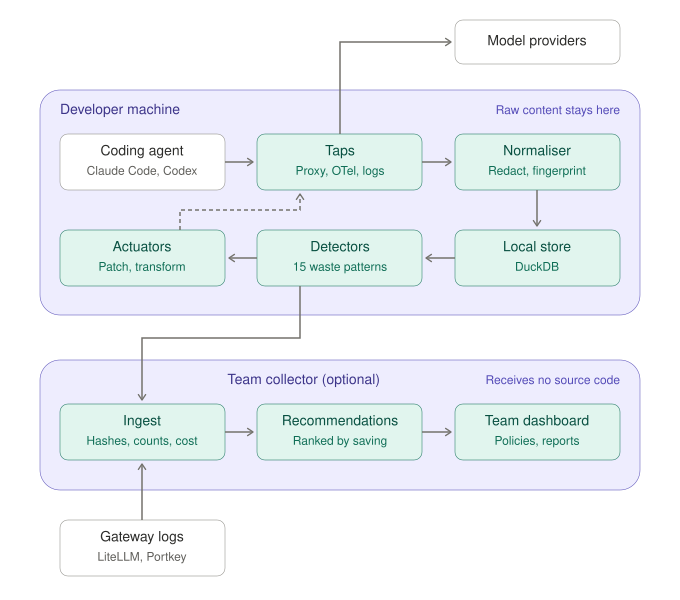

# Trimloop

Trimloop reads the session logs Claude Code keeps on your machine, works out
where your tokens went, and tells you which changes to how you work would save
the most money.

**Status: M0 prototype.** Today it analyses Claude Code logs and gives live
nudges inside Claude Code. It recommends; it does not change anything for
you. The wider product (gateway plugin, team collector, automatic fixes) is
design only: see [The plan](#the-plan).

## What you get

A run on one developer's 45 days of logs, shortened (the full output also
covers their usage limits and Claude Code's own cost records):

```text
Read 574 logs: 573 sessions, 18,601 turns.
Spent $2,330 at list prices from 25 Sep to 9 Nov 2026 (45 days), about $362 a week.

What to do first (these savings overlap, so do not add them):
  1. Compact long sessions earlier: likely about $581 ($557–$694), up to $896 (38%)
     Compact when a session passes about 200,000 tokens, or between tasks.
  2. Run sub-agents on a cheaper model: up to $312 (13%)
     Run sub-agents that search, read and summarise on Sonnet 5.5.
  3. Start fresh after a long break: likely about $301, up to $312 (13%)
     After a break of over an hour, start a new session with a short note instead of carrying on.
```

In plain words: every turn re-sends the whole conversation, so long
sessions get expensive. *Compacting* (`/compact` in Claude Code) replaces
the conversation so far with a short summary. *Sub-agents* are helpers
Claude starts for side tasks, such as searching the code.

The full report explains each finding, shows the sessions behind it, and
gives the fix step by step. **See one:**
[docs/examples/example-report.html](docs/examples/example-report.html) is the
web page from the same run, with session titles left out and project
folders renamed to neutral words (oak, larch, ...). GitHub shows it as
code: download it ("Download raw file") and open it in a browser.

**How far to trust the figures.** They are estimates:

- Costs are at Anthropic's *list prices*: what the tokens would cost if you
  paid per token, not your bill.
- On a Pro or Max plan you pay a flat fee instead. The report says so,
  counts how often you hit a usage limit, and in time shows each saving as
  a share of your weekly limit
  ([ADR 0048](docs/adr/0048-usage-limits-for-subscribers.md)).
- "Up to" is the most a change could save. "Likely" replays your logs as if
  you had made the change.
- Savings overlap (the same tokens can be saved by several changes), so
  they are never added up.
- Claude Code makes some requests its logs do not record. The report says
  how much: 13% in the run above.
- Quality is not measured. Check a change marked "untested for quality" (a
  cheaper model, lower effort) after you make it.

How each figure is worked out is in [docs/measurements.md](docs/measurements.md).

## What it looks for

| Finding | What it means |
|---|---|
| Long sessions (P19) | Every turn re-sends the whole conversation, so big sessions get expensive. When to compact or start fresh. |
| Long breaks (P09) | After an hour away the saved copy of the conversation (the *cache*) expires, and the whole session is paid for again. |
| Short waits (P02) | Sessions whose cache lasts only 5 minutes (sub-agents, and Claude Code run from a program) losing it while waiting on a slow command. |
| Tool output (P04) | Large command output and file reads that stay in the conversation and are re-sent on every turn. |
| What every request carries (P07) | The system prompt, tool definitions, skill lists and memory files sent with each request. |
| Model choice (P13) | Sub-agents and sessions on a more expensive model than the work needs, or on an older, dearer version. |
| Effort level (P14) | Turns at the highest effort levels that think far more than usual, and thinking's share of all output spend. |
| Model switches (P01) | Changing model part-way through a session, which saves the whole conversation to the cache again. |
| Replies cut off (P12) | Replies cut off when the computer slept (or the network failed), so the request was sent again. |

It also checks its totals against Claude Code's own cost records. It shows
spend by project, by skill and by MCP server (the add-on tools Claude Code
connects to). And it keeps week-by-week figures, so you can see whether a
change worked. The codes (P19 and so on) refer to
[docs/patterns.md](docs/patterns.md).

## Install

No release is published yet, so for now build it **from source** (the
last option). Once releases are public, any one of these works:

- **Homebrew** (macOS or Linux):

  ```bash
  brew install --cask chrisadkin8/tap/trimloop
  ```

- **Download**, once releases are public, the archive for your system
  from the [releases page](https://github.com/ChrisAdkin8/trimloop/releases), unpack
  it, and put `trimloop` somewhere on your PATH (for example
  `~/.local/bin`). [Checking a download](#checking-a-download) says how to
  verify it, and what to do if macOS refuses to open it.
- **From source**, with Go 1.27.3 or later: clone this repository, then
  from its folder:

  ```bash
  go build -o ~/.local/bin/trimloop ./cmd/trimloop
  ```

Check it worked with `trimloop --version`. If the shell says "command not
found", the folder is not on your PATH (the list of folders the shell
looks in for commands; on macOS `~/.local/bin` is not on it by default).
Add it, then open a new terminal:

```bash
echo 'export PATH="$HOME/.local/bin:$PATH"' >> ~/.zshrc
```

(Use `~/.bashrc` if your shell is bash.) Or run it as
`~/.local/bin/trimloop` meanwhile.

## Use it

```bash
trimloop                          # short summary, as above
trimloop --open                   # the full report as a web page, opened in your browser
trimloop --format text            # the full report as text
trimloop --format json --out ~/trimloop.json   # every figure, for scripts
```

It reads the logs in `~/.claude/projects` and sends nothing anywhere. The
web page is saved as `trimloop-report.html` in the current folder;
`--out` puts it elsewhere.

### Did a change work?

Add `--since` with the day you made the change:

```bash
trimloop --since 2026-11-01       # sessions started on or after 1 November
trimloop --since 7d               # sessions started in the last 7 days (2w: two weeks)
```

The report then covers only sessions started from then on, with their
sub-agents. Each run also keeps weekly figures (numbers only) in
`~/.trimloop/history.json`, so you can compare weeks even after Claude Code
has deleted old logs. A `--since` run leaves that file alone, so a partial
view never replaces full weeks.

### Before you share a report

Reports show the titles Claude Code gives your sessions, which summarise
what you asked, and your project names. Check a report before sharing it.
`--no-titles` removes the titles, and the web page then shows no session
or connector identifiers either; project, skill and server names stay.

### Try it without your own logs

The repository has a sample session. `CLAUDE_CONFIG_DIR` tells trimloop to
read another folder laid out like `~/.claude`:

```bash
mkdir -p /tmp/trimloop-demo/projects/demo
cp testdata/sessions/tools.jsonl /tmp/trimloop-demo/projects/demo/
CLAUDE_CONFIG_DIR=/tmp/trimloop-demo trimloop --no-history --format text
```

`--no-history` keeps the demo out of your weekly figures. With more than
one Claude Code folder, each gets its own history file.

## Ask Claude about it (Claude Code plugin)

The trimloop plugin adds a skill to Claude Code. Ask "where did my tokens
go?" or "why do I keep hitting my usage limit?", and Claude runs trimloop
and explains the result in plain words. It needs trimloop
[installed](#install). In Claude Code:

```text
/plugin marketplace add ChrisAdkin8/trimloop
/plugin install trimloop@trimloop
```

With Claude Code 2.1.275 or later, one step does both:
`/plugin install trimloop --marketplace ChrisAdkin8/trimloop`. The plugin
changes no settings ([ADR 0049](docs/adr/0049-claude-code-plugin.md)).

## Live nudges in Claude Code

Trimloop can also nudge you while you work:

- a *status line* (the line Claude Code shows below your prompt) with the
  session's size, its cost, and how long its cache has left;
- a message when a session passes 200,000 and 500,000 tokens;
- after a long break in a session over 500,000 tokens, a pause before your
  first message, once, showing what sending it will cost. The pause stops
  that message: it is not sent, and you send it again to go ahead (or
  `/clear` first to start fresh). It also applies to scripted runs
  (`claude -p`) of such a session.

The messages come from *hooks*: commands Claude Code runs after each reply
and before each message. With trimloop [installed](#install):

```bash
trimloop setup                                      # print the settings to add, and the file
trimloop setup --write <the file setup named>       # or add them for you
trimloop setup --check                              # is everything set up and working?
```

With `CLAUDE_CONFIG_DIR` set, Claude Code's settings file is
`settings.json` in that folder: `trimloop setup` names the right one.

`setup --write` saves a backup of your settings first and says how to put
it back. If you already have another status line, it changes nothing at
all, hooks included: add `--replace-statusline` to replace yours, or add
the hooks by hand from what `trimloop setup` prints. `setup --check`
changes nothing. New Claude Code sessions pick up the change. To undo,
copy the backup back, or delete trimloop's `statusLine` and `hooks`
entries. Details:
[ADR 0034](docs/adr/0034-live-nudges.md).

## Files it writes

Everything stays on your machine, readable by you only:

| File | What it holds |
|---|---|
| The report you ask for (`--out`, or `trimloop-report.html`) | Figures, project names and session titles |
| `~/.trimloop/history.json` (or `history-<id>.json`) | Weekly figures only: no names, titles or paths |
| `~/.trimloop/live/<session>.json` | Which nudges a session has been shown |
| `~/.trimloop/nudges.jsonl` | Each nudge shown: time, kind, session size |
| `~/.trimloop/limits.jsonl` (or `limits-<id>.jsonl`) | Pro and Max only: how much of your 5-hour and weekly limits was used, each time it changed |

## The plan

Everything in this section is design, not built yet.

Teams spend real money on coding agents (Claude Code, Codex, Cursor, Copilot)
and on gateways that route their requests (LiteLLM, Portkey, Helicone,
OpenRouter). The tools we have seen answer *where* the money went; few say
*why it was wasted* or *what to change*. Trimloop is designed to join four
steps:

1. **Capture** requests from any coding agent or gateway.
2. **Detect** waste patterns: the ones above, and more
   ([docs/patterns.md](docs/patterns.md)).
3. **Recommend** fixes ranked by money saved, across a whole team.
4. **Apply** the safe ones automatically, with measurement and rollback.

Principles it is designed around:

- **Local-first.** Prompts contain source code and secrets. Raw content will
  never leave the developer's machine unless explicitly enabled; teams will
  share keyed hashes (fingerprints only the customer's key can make), sizes,
  counts and cost, not code or names
  ([ADR 0011](docs/adr/0011-keyed-fingerprints.md),
  [ADR 0019](docs/adr/0019-fingerprint-key-management.md)).
- **Observe before acting.** Recommendations first; changes Trimloop would
  make to requests itself will ship report-only, then in shadow, then to a
  few, then to all, each measured and reversible.
- **Quality is a constraint.** A saving that makes the agent worse is not a
  saving: Trimloop is to track outcome signals (tests, edits, errors) alongside
  cost.
- **Neutral.** One event model for every coding agent, gateway and model
  provider; their differences live in profiles, not in the detectors.



The core will be one Go program; a thin Python plugin will connect LiteLLM to
it; a web UI (TypeScript) will be embedded in the program. Detail:
[docs/design.md](docs/design.md), [docs/analyzer.md](docs/analyzer.md),
[ROADMAP.md](ROADMAP.md) for the order, and
[docs/adr/README.md](docs/adr/README.md) for every decision with whether it is
built.

## Development

To run the prototype you need only Go. To run its checks you also need
`golangci-lint` and `govulncheck`. `scripts/bootstrap.sh` installs what is
missing (macOS with Homebrew, or Debian/Ubuntu):

```bash
scripts/bootstrap.sh --check                       # see what is missing; changes nothing
scripts/bootstrap.sh --skip-node --skip-python     # enough for the prototype and its checks
scripts/bootstrap.sh                               # everything the planned stack needs
```

The full install adds a C toolchain and the DuckDB CLI, `buf` and the
protobuf plugins, `uv` with Python 3.12, and Node.js 22 or later;
`--with-collector` also checks Docker. Re-running is safe.

Before committing Go changes:

```bash
scripts/check.sh             # gofmt, go vet, golangci-lint, race tests, plugin validation, govulncheck
scripts/check.sh --offline   # the same without govulncheck, which needs the network
```

It runs every check, lists the failures and exits 1 if there are any. The
linters are set in [.golangci.yml](.golangci.yml). The code is laid out as:

| Package | What it does |
|---|---|
| `cmd/trimloop` | The command: reads logs, builds sessions, runs the report or a live command |
| `internal/adapters/source` | Log readers: `claudecode` (Claude Code logs), `jsonl` (shared line reader) |
| `pkg/event`, `pkg/price`, `pkg/normalize` | The event model, the price list, usage normalisation |
| `pkg/detectors` | The findings, attribution, reconciliation and weekly figures |
| `pkg/cmdshape` | Shell commands reduced to their shape, without values |
| `pkg/fixes` | Recommendations, with the fix ladder of ADR 0030 |
| `internal/report` | Results, rendered as summary, text, web page and JSON |
| `internal/history` | Weekly figures kept between runs |
| `internal/live` | Status line, hooks and `setup` for Claude Code |

### Releases

Pushing a version tag (`git tag v0.1.0 && git push origin v0.1.0`) runs
[.github/workflows/release.yml](.github/workflows/release.yml), which builds
a draft GitHub release with [GoReleaser](.goreleaser.yaml): archives for
macOS and Linux (Apple silicon, Intel and arm64), `.deb` and `.rpm`
packages, signed checksums, a software bill of materials and build
provenance. Check the draft, then publish it. While the repository is private,
releases skip the signature and provenance (both would need it public or a
paid plan) and stay drafts. **Going public**, in this order: decide whether
to tidy the git history (it goes public too); make this repository public;
delete the v0.1.0 draft and its tag, then tag the current commit and push
the tag (re-running the old workflow would rebuild the old commit); check
the new draft is signed and publish it; then make the tap public
([ADR 0052](docs/adr/0052-third-review-corrections.md)). With a `HOMEBREW_TAP_TOKEN`
secret the release also updates the `ChrisAdkin8/homebrew-tap` cask, for
`brew install --cask chrisadkin8/tap/trimloop`. CI runs the checks and a
release dry run ([ci.yml](.github/workflows/ci.yml)), on
every push to `main` and every pull request.
[ADR 0047](docs/adr/0047-first-release-pure-go.md) has the detail.

#### Checking a download

Download `checksums.txt`, `checksums.txt.sigstore.json` and your archive
into one folder. Releases built while the repository was private have no
`.sigstore.json` file and are not published
([ADR 0051](docs/adr/0051-private-releases-and-going-public.md)). First check
that the release workflow signed the checksums (put the release's tag in
place of `v0.1.0`):

```bash
cosign verify-blob \
  --certificate-identity 'https://github.com/ChrisAdkin8/trimloop/.github/workflows/release.yml@refs/tags/v0.1.0' \
  --certificate-oidc-issuer 'https://token.actions.githubusercontent.com' \
  --bundle checksums.txt.sigstore.json checksums.txt
```

Then check the archive against them:

```bash
shasum -a 256 --check --ignore-missing checksums.txt
```

The macOS binaries are not yet notarised by Apple, so macOS may refuse to
open a downloaded one until you clear its quarantine flag
(`xattr -d com.apple.quarantine ./trimloop`); do that only after both
checks pass. The Homebrew cask does it for you.

## Documents

| Doc | What's in it |
|---|---|
| [docs/measurements.md](docs/measurements.md) | How each figure the prototype reports is worked out today |
| [docs/examples/example-report.html](docs/examples/example-report.html) | A full web-page report from real logs (download and open in a browser) |
| [docs/patterns.md](docs/patterns.md) | Catalogue of waste patterns: signals, detection, fix |
| [docs/state-machines.md](docs/state-machines.md) | What the code remembers between steps, and the files it keeps |
| [docs/log-signals.md](docs/log-signals.md) | What Claude Code logs contain, and the measured figures (§8) |
| [docs/design.md](docs/design.md) | Planned architecture, components, deployment, security |
| [docs/analyzer.md](docs/analyzer.md) | The analysis engine: command line, gateway sidecar, library; harness and provider profiles |
| [docs/value.md](docs/value.md) | Value case: levers ranked by expected saving, validation plan |
| [docs/data-model.md](docs/data-model.md) | Event model and storage |
| [docs/packaging.md](docs/packaging.md) | Release artefacts and pipeline |
| [docs/adr/](docs/adr/README.md) | Decision records, with an index of what is built |
| [ROADMAP.md](ROADMAP.md) | Milestones from this prototype to automatic fixes |

## Licence and security

Licence: [FSL-1.1-ALv2](LICENSE.md).

Outside contributions are not accepted yet: they will need a contributor
licence agreement. Please report security problems
to the maintainer privately rather than in an issue.

Trimloop = **trim** + **loop**: it trims wasted tokens in a loop of detect,
recommend, measure, repeat.
