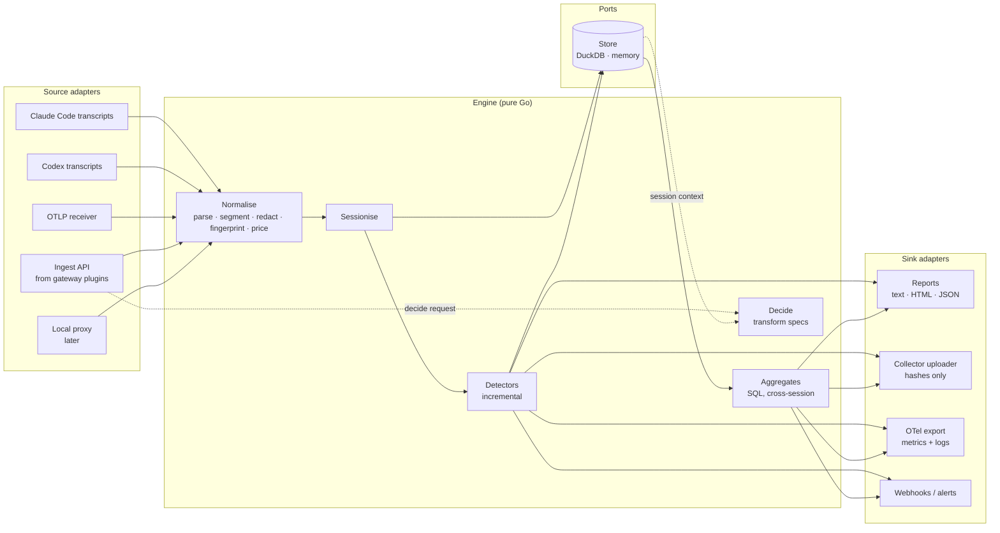
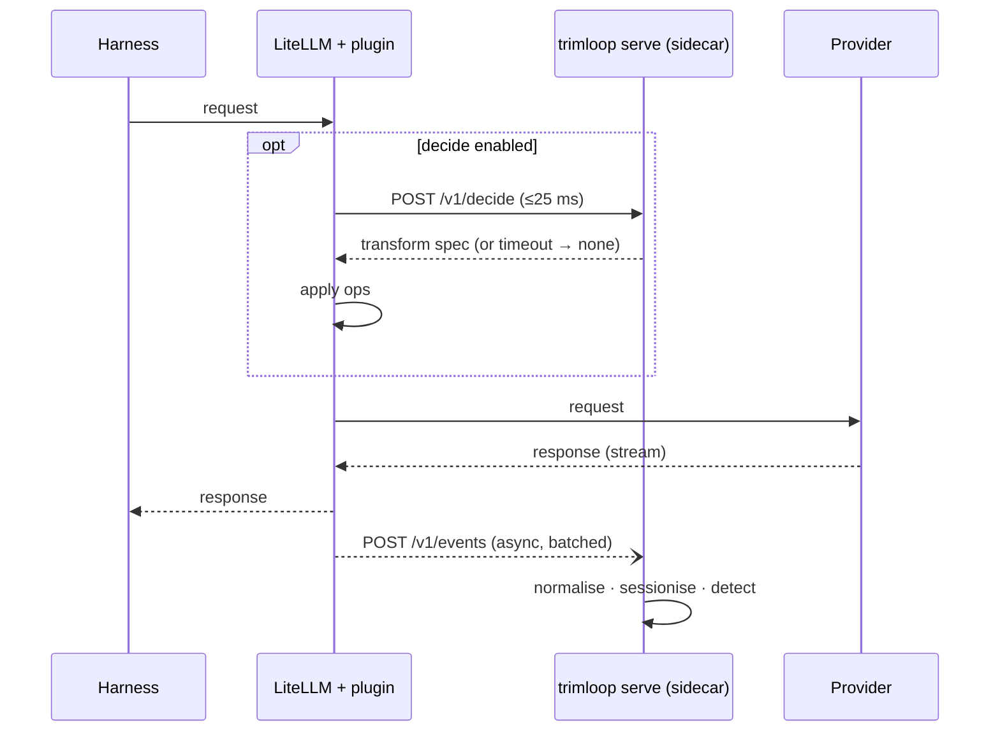

# Analyzer — Design

| | |
|---|---|
| Status | Draft |
| Last updated | 2026-11-05 |
| Scope | The analysis engine: standalone CLI, gateway sidecar, embeddable library |
| Related | [design.md](design.md), [patterns.md](patterns.md), [data-model.md](data-model.md), ADRs [0002](adr/0002-go-for-agent-and-proxy.md), [0005](adr/0005-thin-python-plugin-for-litellm.md), [0006](adr/0006-gateway-plugin-forwards-to-sidecar.md) |

## 1. Goal

One analysis engine that runs, unchanged, in three shapes:

| Shape | Command / form | Input | Typical user |
|---|---|---|---|
| **Standalone batch** | `trimloop analyse` | Session transcripts on disk | A developer, today, with no setup |
| **Gateway sidecar** | `trimloop serve` | Events streamed from a gateway plugin | A team running LiteLLM |
| **Embedded library** | Go package `trimloop/pkg/engine` | Events from any Go host | Envoy external processor, Kong Go plugin, the local proxy |

The engine never knows which shape it is running in. Everything that differs
between shapes lives in **adapters** at the edge.

## 2. Design principles

1. **Ports and adapters.** The core is pure: events in, findings and
   decisions out. Sources, stores and sinks are interfaces.
2. **One detector, two drivers.** Every detector is written once as an
   incremental state machine. Batch mode replays history through it; streaming
   mode feeds it live. Parity between the two is a tested invariant.
3. **Normalise once, in Go.** Provider parsing, redaction and fingerprinting
   exist in one implementation. Gateway plugins forward raw events to a
   co-located sidecar rather than re-implementing them (ADR 0006).
4. **Observe off the hot path.** Watching traffic adds zero latency to model
   calls. Only the optional *decide* path (for automatic fixes) sits in the
   request path, with a strict time budget and fail-open behaviour.
5. **Neutral detectors, described differences.** Detectors never name a
   harness or provider. What differs between them lives in profiles (§10).
6. **Deterministic and replayable.** Same events + same detector versions +
   same price catalogue ⇒ same findings. Every output records the versions
   used.

## 3. Component view



## 4. Core packages

| Package | Responsibility | Pure? |
|---|---|---|
| `pkg/event` | Canonical model (Session, Turn, Segment, ToolCall, Outcome, Finding) and the versioned wire schema (`proto/trimloop/v1`) | yes |
| `pkg/normalize` | Provider parsers (Anthropic Messages, OpenAI Chat Completions and Responses, Gemini) → Turn + ordered Segments | yes |
| `pkg/redact` | Secret detection and replacement before anything is stored | yes |
| `pkg/fingerprint` | Normalisation + SHA-256 per segment; rolling prefix hashes; chunk hashes. Spec and test vectors in `pkg/fingerprint/testdata` | yes |
| `pkg/price` | Versioned price catalogue; cost per token class | yes |
| `pkg/profile` | Provider and harness profiles, capability sets, registry (§10) | yes |
| `pkg/sessionize` | Group turns into sessions when the source does not (gateway case, §6) | stateful, in-memory |
| `pkg/detect` | Detector interface, registry, incremental driver | yes (state passed in) |
| `pkg/detectors` | One file per pattern: `p01_cache_churn.go`, … | yes |
| `pkg/aggregate` | Cross-session SQL detectors (repo / developer / org scope) | runs on a Store |
| `pkg/decide` | Turns policy + session context into a declarative transform spec (L2/L3) | yes |
| `pkg/store` | Store interface; `duckdb` and `memory` implementations | adapter |
| `pkg/engine` | Wires the above; the public embedding API | — |

### Key interfaces (sketch)

```go
// A Source produces raw events from somewhere: files, a socket, an HTTP body.
type Source interface {
    Name() string
    Run(ctx context.Context, emit func(event.Raw) error) error
}

// A Detector is an incremental state machine over one session.
// Batch mode replays a session's turns in order; streaming mode calls
// OnTurn as turns arrive. Both must yield identical findings.
type Detector interface {
    ID() string          // "P01"
    Version() string     // bump on any logic change
    Requires() Capabilities // needed and optional capabilities (§10.4)
    NewState() any       // per-session state
    OnTurn(st any, s *event.Session, t *event.Turn) []event.Finding
    OnSessionEnd(st any, s *event.Session) []event.Finding
}

// An Aggregate runs across sessions in a Store (e.g. P06 unused tools
// per repo, P15–P18 cross-session repeats). Written as SQL.
type Aggregate interface {
    ID() string
    Version() string
    Query() string
}

type Sink interface {
    Write(ctx context.Context, findings []event.Finding) error
}

// The embedding API.
type Engine interface {
    Ingest(ctx context.Context, raw event.Raw) error      // observe path
    Decide(ctx context.Context, req event.DecideRequest) (event.TransformSpec, error) // decide path
    CloseIdleSessions(ctx context.Context, now time.Time) error
    RunAggregates(ctx context.Context) error
}
```

`event.Raw` is the seam between every source and the core: provider,
endpoint, request body, response body or usage block, timings, HTTP status,
allow-listed headers (never auth), and source metadata (harness, gateway
team/key alias, cwd/repo when known).

## 5. The three shapes

### 5.1 Standalone: `trimloop analyse`

```text
trimloop analyse [--harness claude-code|codex|all] [--since 30d]
                 [--repo PATH] [--format text|html|json] [--out FILE]
```

1. Source adapters discover transcripts (Claude Code: `~/.claude/projects/**/*.jsonl`;
   Codex: its session log directory).
2. Each transcript is already one session, so `sessionize` is bypassed.
3. Turns are replayed through the incremental detectors in order.
4. Sessions and findings are written to `~/.trimloop/trimloop.duckdb`;
   aggregates run over the store.
5. A report is rendered. No network access at any point.

Incremental re-runs: the store records each transcript's path, size and last
offset, so a second run only reads new lines.

Transcript limits: transcripts record what the harness chose to log. They
show *that* a cache was re-written (usage fields), but may not include the full
system prompt or tool definitions as sent, so P01 root-cause detail is lower
than from a gateway or proxy. Findings carry a `fidelity` field
(`transcript` | `wire`) so the report can say so.

### 5.2 Gateway sidecar: `trimloop serve`

```text
trimloop serve --listen 127.0.0.1:7341 [--decide] [--store duckdb|memory]
               [--upload https://collector.example.com]
```

Runs next to the gateway (same pod or host). Exposes:

| Endpoint | Purpose | Latency budget |
|---|---|---|
| `POST /v1/events` (batched, protobuf or JSON) | Observe path: plugin forwards completed calls | Async; plugin never waits on it |
| `POST /v1/decide` | Decide path: plugin asks for a transform before the call | p99 < 10 ms; plugin times out at 25 ms and fails open |
| `GET /v1/health`, `/metrics` | Liveness, Prometheus metrics | — |

Binding to loopback by default means raw request bodies cross only the local
network stack inside the gateway's host or pod (ADR 0006). The sidecar
normalises, redacts and fingerprints; only hashes, counts, cost and findings
are written to disk or uploaded.

The sidecar also serves as the **team collector** when run centrally with
`--store duckdb` swapped for the ClickHouse store — same binary, different
adapters.

### 5.3 Embedded library

Hosts written in Go import `pkg/engine` directly and call `Ingest` and
`Decide` in-process:

- **Local proxy** (M4): tees each request/response into `Ingest`.
- **Envoy external processor**: a small gRPC service implementing Envoy's
  external-processing API, calling `Decide` on request headers/body and
  `Ingest` on the response.
- **Kong Go plugin**: same calls from Kong's Go plugin server.

## 6. Sessionising gateway traffic

Gateways see independent HTTP requests, not sessions. Detectors need
sessions. `pkg/sessionize` rebuilds them:

1. **Explicit id.** If the harness sends a session identifier (header or
   metadata field), use it.
2. **Prefix continuity.** Otherwise: a coding agent's request *n+1* contains
   request *n*'s messages plus *n*'s response as its history prefix. For every
   turn, compute rolling prefix hashes at each message boundary. Keep an index
   `prefix_hash(turn n input + turn n output) → session`. A new turn whose
   history prefix matches an indexed hash joins that session; otherwise it
   opens a new one.
3. **Scoping.** Matching is restricted to the same gateway key / user and
   harness (from `User-Agent` or metadata), within an idle window
   (default 60 min), which also closes sessions.
4. **Forks and compaction.** A compaction or `/clear` breaks the prefix and
   starts a new session linked by `resumed_from` when the system prompt and
   tool-definition fingerprints match the previous one.

Index memory is bounded (LRU on open sessions); evicted sessions are closed
and `OnSessionEnd` runs.

## 7. Detector execution

| Scope | Mechanism | Batch | Streaming |
|---|---|---|---|
| Turn, session | Incremental `Detector` | Replay turns in order | `OnTurn` per arrival; `OnSessionEnd` on idle close |
| Repo, developer, org | SQL `Aggregate` over the store | After import | Every N minutes (default 15) and on demand |

**Parity invariant.** CI replays every fixture session through both drivers —
once as a batch, once as a shuffled-arrival stream across interleaved sessions
— and asserts identical findings. This is what lets the same detectors serve
the CLI and the gateway.

**Versioning.** Each finding stores `detector_id@version`,
`price_catalogue_version` and `fidelity`. Re-running with newer detectors
produces new findings; old ones are kept for before/after comparisons.

## 8. Decide path (automatic fixes)

`Decide` returns a **declarative transform spec**, never code:

```json
{
  "transform_version": "t-2026.11.1",
  "session_id": "s_…",
  "ops": [
    {"op": "sort_tools", "by": "name"},
    {"op": "move_segment", "kind": "memory_file", "source_hash": "…", "to": "after_breakpoint"},
    {"op": "set_cache_ttl", "value": "1h"}
  ],
  "mode": "canary"
}
```

- The plugin or host applies the ops mechanically. Ops are a small closed set,
  each with a reference implementation and test vectors, so the Python plugin
  and Go hosts cannot diverge.
- Policy (from the team collector, signed) decides which ops are enabled and
  in which rollout mode: `off`, `shadow`, `canary`, `on`.
- In `shadow` the spec is returned with `apply: false` and the would-be effect
  is logged.
- Any error or timeout ⇒ empty spec ⇒ request goes through unchanged.
- Only ops listed in the provider profile's `ops` are ever returned (§10.2);
  for example `set_cache_ttl` exists for Anthropic, `set_cache_key` for OpenAI.

## 9. The thin LiteLLM plugin

Package `trimloop-litellm` (Python), roughly 300 lines. It subclasses
LiteLLM's `CustomLogger`:

| Hook | What the plugin does |
|---|---|
| `async_log_success_event` / `async_log_failure_event` | Build an `event.Raw` from the request, response, usage and timings; append to an in-memory ring buffer |
| Background task | Flush the buffer to `POST /v1/events` every 1 s or 100 events; drop and count on overflow |
| `async_pre_call_hook` (only if `decide` enabled) | `POST /v1/decide` with a 25 ms timeout; apply returned ops to `data`; on any failure return `data` unchanged |

It contains no parsing beyond reading LiteLLM's own objects, no detectors and
no fingerprinting. When the sidecar is not co-located (ADR 0006, remote mode)
it can fingerprint locally using the shared spec and test vectors.



## 10. Extensibility: harnesses and providers

Two things vary independently: the **harness** (Claude Code, Codex, Gemini
CLI, …) and the **provider API** the traffic goes to (Anthropic Messages,
OpenAI Responses, Claude on Bedrock, …). Each is described by a **profile**: a
YAML file for the declarative facts plus a small amount of Go for parsing.

Detectors never name a harness or provider. They declare the **capabilities**
they need; profiles declare the capabilities they provide; the engine matches
the two.

### 10.1 Capabilities

| Capability | Meaning | Typically provided by |
|---|---|---|
| `usage.cache_read` | Cached-input tokens reported per turn | All major providers |
| `usage.cache_write` | Tokens written to cache, billed separately | Anthropic (direct, Bedrock, Vertex) |
| `usage.reasoning` | Reasoning / thinking tokens reported | Providers with reasoning models |
| `request.full_body` | Full request as sent: system prompt, tool definitions, history | Gateway, proxy; transcripts only partly |
| `request.cache_markers` | Explicit cache breakpoints in the request | Anthropic |
| `response.tool_calls` | Tool calls and results identifiable | All |
| `session.explicit_id` | Source supplies a session id | Transcripts; some harnesses via headers |
| `context.repo` | Repo, branch and working directory known | Transcripts, local proxy — not gateways |
| `harness.config` | Harness config files readable (MCP servers, memory files) | Local shapes only |
| `harness.skills` | Harness supports on-demand skills or an equivalent (slash commands, custom prompts) | Harness profile |
| `content.local` | Raw text readable on this machine when a recommendation is rendered (transcripts on disk, or full local capture) | Local shapes only |
| `outcome.git` | Git outcomes linkable to sessions | Local shapes only |
| `timing.per_turn` | Request and response timestamps | All |

A session's **effective capabilities** = provider profile ∩ harness profile ∩
shape. For example, gateway traffic from Claude Code has `request.full_body`
but not `context.repo`; a Claude Code transcript has `context.repo` but may
lack `request.full_body`.

### 10.2 Provider profiles

One profile per **API surface** (request/response format and host). Profiles
for the same model family share a **cache model**.

```yaml
id: anthropic-messages
api: anthropic.messages.v1
hosts: [api.anthropic.com]
parser: normalize/anthropic
model_families:
  - match: "claude-*"
    tokenizer: estimate              # no local tokenizer; counts flagged as estimates
cache:
  kind: explicit_breakpoints         # explicit_breakpoints | automatic_prefix | implicit_and_managed
  write_billed: true
  ttl_options: [5m, 1h]
usage_fields:
  cache_read: usage.cache_read_input_tokens
  cache_write: usage.cache_creation_input_tokens
capabilities: [usage.cache_read, usage.cache_write, usage.reasoning,
               request.cache_markers, response.tool_calls, timing.per_turn]
ops: [sort_tools, move_segment, set_cache_breakpoint, set_cache_ttl]
```

```yaml
id: openai-responses
api: openai.responses.v1
hosts: [api.openai.com]
parser: normalize/openai
model_families:
  - match: "gpt-*"
    tokenizer: local
cache:
  kind: automatic_prefix
  write_billed: false
  ttl_options: provider_managed
usage_fields:
  cache_read: usage.input_tokens_details.cached_tokens
capabilities: [usage.cache_read, usage.reasoning, response.tool_calls, timing.per_turn]
ops: [sort_tools, move_segment, set_cache_key]
```

Claude on Bedrock or Vertex gets its own profile (different envelope and
host) with `cache: { inherit: anthropic-messages }`.

The three cache models, and what they mean for detectors:

| Cache model | You control | Billing | Detector impact |
|---|---|---|---|
| `explicit_breakpoints` | Where caching stops; lifetime option | Write premium, read discount | P01/P02 measure write waste and can place breakpoints |
| `automatic_prefix` | Only prefix stability (and, where offered, a cache key or retention option) | No write cost, read discount | P01/P02 measure missed reads; fewer automatic fixes |
| `implicit_and_managed` | Implicit prefix caching, plus caches you create with a TTL and storage cost | Read discount; storage billed for managed caches | P01/P02 also detect managed caches re-created or kept too long |

Per-model detail lives in [patterns.md](patterns.md) P01 and P02.

### 10.3 Harness profiles

```yaml
id: claude-code
versions: ">=2.0"
detect:
  user_agent: "^claude-cli/"         # verified per version by the conformance kit
transcripts:
  paths: ["~/.claude/projects/**/*.jsonl"]
  parser: adapters/source/claudecode
memory_files: ["CLAUDE.md", "CLAUDE.local.md"]
config_files: [".mcp.json", ".claude/settings.json"]
skills: { kind: skill_md, paths: [".claude/skills/", "~/.claude/skills/"] }
capabilities: [session.explicit_id, context.repo, harness.config, harness.skills,
               content.local, outcome.git]
fix_templates: templates/claude-code/
```

A harness profile tells the engine how to find and parse the harness's logs,
how to recognise its traffic at a gateway, which request segments are its
memory files (so P07 can attribute standing context), where its config lives
(so P06 can name the MCP server to disable), and which template renders each
recommendation in that harness's own terms. Values in the example are
starting points; every path, file name and header is confirmed against
recorded fixtures before a profile is enabled.

### 10.4 Capability-gated detectors

Each detector declares **required** capabilities (any-of groups allowed) and
**optional** ones that improve its output:

| Pattern | Required | Optional (raises fidelity) |
|---|---|---|
| P01 Cache-prefix churn | `usage.cache_read` | `request.full_body`, `usage.cache_write`, `request.cache_markers` |
| P02 Cache TTL expiry | `usage.cache_read`, `timing.per_turn` | `usage.cache_write` |
| P03 Repeated file reads | `response.tool_calls` | `request.full_body` |
| P04 Oversized tool output | `response.tool_calls` | — |
| P05 Tool-call loops | `response.tool_calls` | `outcome.git` |
| P06 Unused tool definitions | `request.full_body` **or** `harness.config` | — |
| P07 Bloated standing context | `request.full_body` **or** `context.repo` | `harness.config`, `content.local` |
| P16 Repeated workflow | `response.tool_calls` | `content.local`, `harness.skills` |
| P17 Repeated instructions | — | `content.local`, `harness.skills` |
| P18 Hot documentation | `response.tool_calls` | `content.local`, `harness.skills` |

For each session the engine resolves a status per detector:

- **ran** — all required and optional capabilities present;
- **reduced** — required present, some optional missing (e.g. P01 sees churn
  but cannot name the segment that caused it);
- **not applicable** — a required capability is missing; the detector does
  not run.

Status is stored as a `DetectorCoverage` record ([data-model.md](data-model.md)).
Reports include a coverage section and never show "0 findings" for a
detector that did not run.

### 10.5 Conformance kit

`trimloop conformance --provider <id>` or `--harness <id>` checks:

1. The profile matches the schema.
2. Every claimed capability is present in the profile's recorded fixtures —
   claims are tested, not trusted.
3. Parser output on fixtures matches golden events.
4. Detectors produce the golden findings on the profile's fixture sessions.
5. Fingerprint vectors pass, and every listed op applies correctly.
6. Harness detection rules match that harness's traffic and no other's.

Passing is required before a profile is enabled by default. Community profiles
can ship marked `experimental`.

### 10.6 Adding support

| To add | You write | You don't touch |
|---|---|---|
| A new model on a known provider | Price catalogue entry; `model_families` match | Code |
| A new provider / API surface | Provider profile; parser in `pkg/normalize`; price entries; recorded fixtures (including streamed responses) | Detectors |
| A new harness | Harness profile; transcript parser (if it writes logs); fix templates; recorded fixtures | Detectors, parsers for providers it uses |

## 11. Configuration

One file, `trimloop.yaml`, read by every shape; CLI flags override it.

```yaml
capture:
  content: hashes          # hashes | full (full is local-only, per repo)
sources:
  claude_code: { enabled: true }
  codex:       { enabled: true }
serve:
  listen: 127.0.0.1:7341
  decide: false
store:
  kind: duckdb             # duckdb | memory | clickhouse
  path: ~/.trimloop/trimloop.duckdb
detectors:
  disabled: []             # e.g. [P07]
  thresholds:
    P04.max_tool_output_tokens: 8000
sinks:
  report: { format: text }
  otel:   { endpoint: "" } # export findings as OTel metrics/logs
  upload: { url: "" }      # team collector; hashes only
pricing:
  catalogue: builtin       # or a path, for negotiated rates
```

The OTel sink lets teams see Trimloop findings in the observability tool they
already use (Datadog, Grafana, etc.).

## 12. Repository layout

```text
cmd/trimloop/               CLI: analyse, serve, report, explain, version
pkg/engine/                 public embedding API
pkg/event/                  canonical model
pkg/normalize/{anthropic,openai,gemini}/
pkg/redact/
pkg/fingerprint/            spec + testdata/vectors.json
pkg/price/                  catalogue.yaml embedded
pkg/profile/                profile types, capability sets, registry
pkg/sessionize/
pkg/detect/                 interfaces, registry, drivers
pkg/detectors/              p01_cache_churn.go … one per pattern
pkg/aggregate/              *.sql + runner
pkg/decide/                 ops, policy evaluation
pkg/store/{duckdb,memory,clickhouse}/
adapters/source/{claudecode,codex,otlp,ingest}/
adapters/sink/{report,otel,upload,webhook}/
proto/trimloop/v1/          events.proto, decide.proto
profiles/providers/         one YAML per API surface (anthropic-messages, openai-responses, …)
profiles/harnesses/         one YAML per harness (claude-code, codex, …)
templates/<harness>/        fix-recommendation templates per pattern
plugins/litellm/            Python package trimloop-litellm
testdata/sessions/          redacted fixture sessions + expected findings
```

`pkg/` is public so Envoy/Kong hosts and third parties can embed the engine;
adapters stay outside it so the core has no I/O dependencies. Packaging adds
`cmd/trimloop-kong/`, `internal/collector/`, `web/`, `deploy/` and
`.goreleaser.yaml` ([packaging.md §12](packaging.md#12-repository-layout-additions)).

## 13. Performance targets

| Path | Target |
|---|---|
| `trimloop analyse`, 30 days of one developer's sessions | < 30 s cold, < 3 s incremental |
| Sidecar ingest | ≥ 2,000 turns/s per core; memory bounded by open-session LRU |
| `Decide` | p99 < 10 ms server side |
| Plugin overhead on the request path | 0 ms with decide off; ≤ 25 ms worst case with decide on |

## 14. Testing

- **Golden fixtures.** Redacted real sessions in `testdata/sessions/` with
  expected findings; every detector change must update them deliberately.
- **Parity.** Batch vs streaming drivers (§7).
- **Conformance kit.** Every provider and harness profile must pass
  `trimloop conformance` before it is enabled by default (§10.5).
- **Fingerprint and op vectors.** Shared JSON vectors run by both Go and the
  Python plugin's test suite.
- **Provider contract tests.** Recorded request/response pairs per provider
  and harness version.
- **Plugin matrix.** The LiteLLM plugin is tested against each supported
  LiteLLM minor version, including hook-signature changes.
- **Fail-open tests.** Kill the sidecar mid-traffic; assert zero failed
  model calls.

## 15. Build order

1. `pkg/event`, `normalize/anthropic`, `fingerprint`, `price`, Claude Code
   source, memory store, detectors P01–P07, text report → **`trimloop analyse` (M0)**.
2. DuckDB store, incremental re-runs, HTML/JSON reports, Codex source.
3. Ingest API, `sessionize`, `trimloop serve`, LiteLLM plugin (observe only).
4. Aggregates, OTel sink, upload sink → team collector.
5. `decide`, ops, policy, plugin pre-call hook (shadow first).

## 16. Open questions

1. Do current Claude Code transcripts include enough of the request (system
   prompt, tool definitions) for P01 root causes, or only usage figures?
   Determines how much M0 can say about *why* caches break.
2. Which harnesses send an explicit session identifier through a gateway?
   Affects how often §6 falls back to prefix continuity.
5. Which capabilities do Claude Code transcripts actually provide? If they
   lack tool definitions, P06 depends on reading harness config from disk
   (`harness.config`) in M0.
6. For providers with no local tokenizer, how large is the token-estimate
   error, and should findings that depend on estimates carry lower
   confidence by default?
3. Is the LiteLLM success callback guaranteed to carry final usage for
   streamed responses in every supported version?
4. Should `serve` support a Unix socket as well as loopback TCP, to tighten
   the local-only guarantee?
