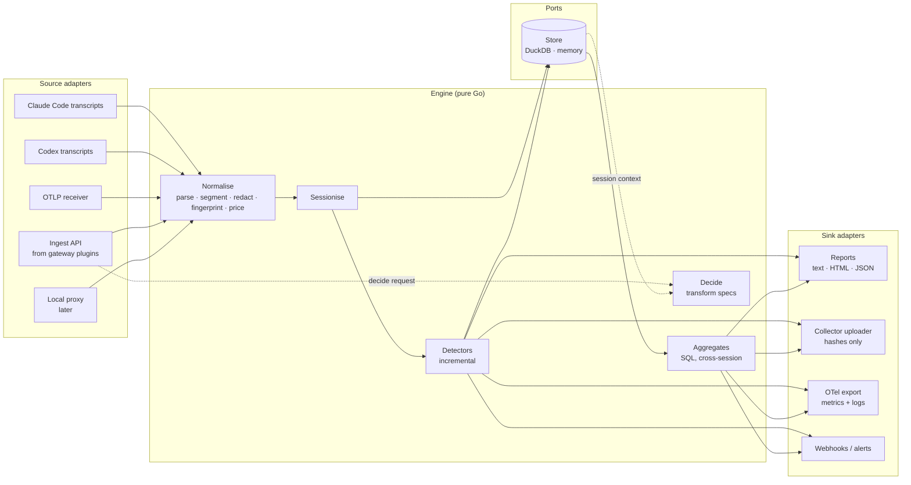
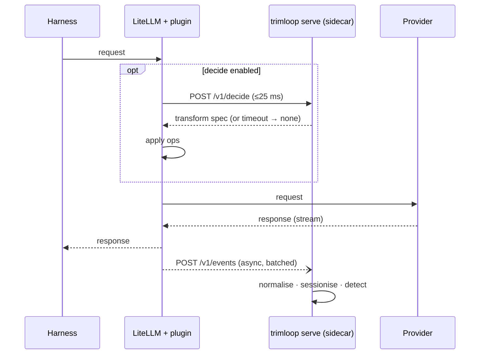

# Analyzer — Design

| | |
|---|---|
| Status | Draft |
| Last updated | 2026-11-05 |
| Scope | The analysis engine: standalone CLI, gateway sidecar, embeddable library |
| Related | [design.md](design.md), [patterns.md](patterns.md), [data-model.md](data-model.md), ADRs [0002](adr/0002-go-for-agent-and-proxy.md), [0005](adr/0005-thin-python-plugin-for-litellm.md), [0006](adr/0006-gateway-plugin-forwards-to-sidecar.md) |

## 1. Goal

One analysis engine that runs, unchanged, in three shapes:

| Shape | Command / form | Input | Typical user |
|---|---|---|---|
| **Standalone batch** | `trimloop analyse` | Session transcripts on disk | A developer, today, with no setup |
| **Gateway sidecar** | `trimloop serve` | Events streamed from a gateway plugin | A team running LiteLLM |
| **Embedded library** | Go package `trimloop/pkg/engine` | Events from any Go host | Envoy external processor, Kong Go plugin, the local proxy |

The engine never knows which shape it is running in. Everything that differs
between shapes lives in **adapters** at the edge.

## 2. Design principles

1. **Ports and adapters.** The core is pure: events in, findings and
   decisions out. Sources, stores and sinks are interfaces.
2. **One detector, two drivers.** Every detector is written once as an
   incremental state machine. Batch mode replays history through it; streaming
   mode feeds it live. Parity between the two is a tested invariant.
3. **Normalise once, in Go.** Provider parsing, redaction and fingerprinting
   exist in one implementation. Gateway plugins forward raw events to a
   co-located sidecar rather than re-implementing them (ADR 0006).
4. **Observe off the hot path.** Watching traffic adds zero latency to model
   calls. Only the optional *decide* path (for automatic fixes) sits in the
   request path, with a strict time budget and fail-open behaviour.
5. **Neutral detectors, described differences.** Detectors never name a
   harness or provider. What differs between them lives in profiles (§10).
6. **Deterministic and replayable.** Same events + same detector versions +
   same price catalogue ⇒ same findings. Every output records the versions
   used.

## 3. Component view



## 4. Core packages

| Package | Responsibility | Pure? |
|---|---|---|
| `pkg/event` | Canonical model (Session, Turn, Segment, ToolCall, Outcome, Finding) and the versioned wire schema (`proto/trimloop/v1`) | yes |
| `pkg/normalize` | Provider parsers (Anthropic Messages, OpenAI Chat Completions and Responses, Gemini) → Turn + ordered Segments | yes |
| `pkg/redact` | Secret detection and replacement before anything is stored | yes |
| `pkg/fingerprint` | Exact and content hashes per segment; prefix chains; line hashes ([spec](data-model.md#fingerprinting)). Spec and test vectors in `pkg/fingerprint/testdata` | yes |
| `pkg/price` | Versioned price catalogue; cost per token class | yes |
| `pkg/profile` | Provider and harness profiles, capability sets, registry (§10) | yes |
| `pkg/sessionize` | Group turns into sessions when the source does not (gateway case, §6) | stateful, in-memory |
| `pkg/detect` | Detector interface, registry, incremental driver | yes (state passed in) |
| `pkg/detectors` | One file per pattern: `p01_cache_churn.go`, … | yes |
| `pkg/aggregate` | Cross-session aggregates (repo / developer / org scope): SQL, plus P16's Go sequence miner | runs on a Store |
| `pkg/decide` | Turns policy + session context into a declarative transform spec (L2/L3) | yes |
| `pkg/store` | Store interface and the memory implementation; DuckDB and ClickHouse stores live in `internal/store` | adapter |
| `pkg/engine` | Wires the above; the public embedding API | — |

### Key interfaces (sketch)

```go
// A Source produces raw events from a live stream: a socket, an HTTP body
// (the gateway ingest API, the OTLP receiver, the local proxy).
type Source interface {
    Name() string
    Run(ctx context.Context, emit func(event.Raw) error) error
}

// A Reader reads one harness's session logs from disk (Claude Code, Codex, …).
// Discover and Read are separate so that a re-run reads only new lines
// (Log.Offset) and the user can choose which harness to read (--harness).
type Reader interface {
    Name() string                                                   // "claude-code"
    Discover(ctx context.Context) ([]Log, error)                    // find logs on disk
    Read(ctx context.Context, log *Log) iter.Seq2[event.Raw, error] // stream one log; advances log.Offset
}

type Log struct {
    Path   string
    Offset int64 // where the previous run stopped
}

// Reader contract:
// - Read starts at log.Offset and moves it past each complete line it reads.
//   The caller saves the new offset only after saving what was read.
// - Read stops before a final line with no newline (still being written);
//   that line is read on the next run.
// - If the log is now shorter than log.Offset, it was replaced or cut short;
//   Read starts again from the beginning.
// - Read yields every line that carries usage, repeats included. The caller
//   counts each message id once across all logs and runs (ADR 0026).

// A Detector is an incremental state machine over one session.
// Batch mode replays a session's turns in order; streaming mode calls
// OnTurn as turns arrive. Both must yield identical findings.
type Detector interface {
    ID() string          // "P01"
    Version() string     // bump on any logic change
    Requires() Capabilities // needed and optional capabilities (§10.4)
    NewState() State     // per-session state; serialisable (§7)
    OnTurn(st State, s *event.Session, t *event.Turn) []event.Finding
    OnSessionEnd(st State, s *event.Session) []event.Finding
}

// An Aggregate runs across sessions in a Store (P06, P07, P15–P18).
// Most are SQL (SQLAggregate wraps a query); P16's sequence miner is Go.
// Like a Detector, it declares capabilities and reports coverage per group.
type Aggregate interface {
    ID() string
    Version() string
    Requires() Capabilities
    GroupBy() Scope // repo, developer, org — or gateway key when repo is unknown (§10.4)
    Run(ctx context.Context, st store.Reader) ([]event.Finding, []event.DetectorCoverage, error)
}

type Sink interface {
    Write(ctx context.Context, findings []event.Finding) error
}

// The embedding API.
type Engine interface {
    Ingest(ctx context.Context, raw event.Raw) error      // observe path
    Decide(ctx context.Context, req event.DecideRequest) (event.TransformSpec, error) // decide path
    CloseIdleSessions(ctx context.Context, now time.Time) error
    RunAggregates(ctx context.Context) error
}
```

`event.Raw` is the seam between every source and the core: provider,
endpoint, request body, response body or usage block, timings, HTTP status,
allow-listed headers (never auth), and source metadata (harness, gateway
team/key alias, cwd/repo when known).

## 5. The three shapes

### 5.1 Standalone: `trimloop analyse`

```text
trimloop analyse [--harness claude-code|codex|all] [--since 30d]
                 [--repo PATH] [--format text|html|json] [--out FILE]
                 [--rebuild]
```

1. Source adapters discover transcripts (Claude Code: `~/.claude/projects/**/*.jsonl`;
   Codex: its session log directory).
2. Each transcript is already one session, so `sessionize` is bypassed.
3. Turns are replayed through the incremental detectors in order.
4. Sessions and findings are written to `~/.trimloop/trimloop.duckdb`;
   aggregates run over the store.
5. A report is rendered. No network access at any point. Text, HTML and
   JSON render the same results: the HTML page is one self-contained file
   (inline styles, charts and script; a content security policy that
   forbids loading anything), and the JSON layout is versioned
   (`trimloop-report/1`; adding fields keeps the version, removing or
   changing one bumps it).

Incremental re-runs: the store records each transcript's path, size and last
offset, so a second run only reads new lines.

Transcript contents vary by harness and version. A survey of local Claude
Code transcripts (versions 2.1.288–2.1.318, 2026-11-05) found:

- `api-request-shape` lines holding the system prompt and tool definitions,
  keyed by `shapeHash`, and `api-request` lines that reference a shape plus
  message blobs (`api-request-blob`). The request as sent can therefore
  largely be rebuilt, giving `request.full_body` for these versions.
- Usage blocks with `cache_creation.ephemeral_5m_input_tokens` and
  `ephemeral_1h_input_tokens`, and `output_tokens_details.thinking_tokens`.
- An assistant message split across several lines (one per content block),
  each repeating the **same** usage block. Usage is counted once per message
  id; summing lines double-counts.
- Sub-agent transcripts in sub-folders, with `isSidechain` set; the reader
  includes them and links them to the parent session.
- Claude Code deletes old transcripts after a retention period
  (`cleanupPeriodDays`), which bounds `--since` and `--rebuild`.

Older or other harnesses may log less. Findings carry a `fidelity` field
(`transcript`, `gateway` or `wire`) so the report can say so.

### 5.2 Gateway sidecar: `trimloop serve`

```text
trimloop serve --listen 127.0.0.1:7341 [--decide] [--store duckdb|memory|clickhouse]
               [--upload https://collector.example.com]
```

Runs next to the gateway (same pod or host). Exposes:

| Endpoint | Purpose | Latency budget |
|---|---|---|
| `POST /v1/events` (batched, protobuf or JSON) | Observe path: plugin forwards completed calls | Async; plugin never waits on it |
| `POST /v1/decide` | Decide path: plugin asks for a transform before the call | p99 < 10 ms; plugin times out at 25 ms and fails open |
| `GET /v1/health`, `/metrics` | Liveness, Prometheus metrics | — |
| `GET /v1/findings`, `/` on the findings port (default `:7342`, token auth) | Read-only findings, coverage and session summaries, and a small page — the M1 output ([ADR 0016](adr/0016-m1-sidecar-operation.md)) | — |

Binding to loopback by default means raw request bodies cross only the local
network stack inside the gateway's host or pod (ADR 0006). The sidecar
normalises, redacts and fingerprints; only hashes, counts, cost and findings
are written to disk or uploaded.

The sidecar also serves as the **team collector** when run centrally with
`--store clickhouse` (plus Postgres for recommendations and policy) — same binary, different
adapters.

### 5.3 Embedded library

Hosts written in Go import `pkg/engine` directly and call `Ingest` and
`Decide` in-process:

- **Local proxy** (M4): tees each request/response into `Ingest`.
- **Envoy external processor**: a small gRPC service implementing Envoy's
  external-processing API, calling `Decide` on request headers/body and
  `Ingest` on the response.
- **Kong Go plugin**: same calls from Kong's Go plugin server.

## 6. Sessionising gateway traffic

Gateways see independent HTTP requests, not sessions. Detectors need
sessions. `pkg/sessionize` rebuilds them:

1. **Anchor.** Every session has an anchor: the harness's own session id
   when the request carries one, otherwise
   `fp("root", harness ‖ principal ‖ first user_text)` — which excludes
   system, tool, memory-file and injected segments, so a system prompt that
   changes every turn does not change it
   ([ADR 0020](adr/0020-session-identity.md)).
2. **Joining.** A request joins open session *S* when it has the same anchor
   **and** its history contains *S*'s most recent assistant response (by
   content hash). Otherwise it opens a new session. If two open sessions
   match, the one with the most recent turn wins.
3. **Scoping.** Matching is restricted to the same gateway key / user and
   harness (from `User-Agent` or metadata), within an idle window
   — the larger of 2 hours and the longest cache TTL observed in the session,
   capped at 24 hours, so P02 sees expiries — which also closes sessions.
   Turns are first held per gateway key for a 5-second **reorder window** and
   released in request-timestamp order; a late turn that shows two open
   sessions are one merges them and replays their detectors.
4. **History edits.** Harnesses rewrite history: providers clear old tool
   results, and Claude Code records requests as an earlier request cut to
   `keep` messages plus a new `tail`. Because joining needs only the latest
   response, edits do not break a session; the first point where the request
   differs from *S*'s previous one is recorded as `history_edit_at`, and P01
   attributes cache breaks there to context editing.
5. **Forks and compaction.** A compaction or `/clear` replaces the history,
   so the request opens a new session, linked by `resumed_from` when its
   anchor matches.

6. **Kinds.** Each session is labelled `main`, `subagent` or `auxiliary`
   (titles, summaries and similar side calls), by rules in the harness
   profile. Sub-agents link to their parent session. Per-session statistics
   count `main` sessions only.

Index memory is bounded (LRU on open sessions); evicted sessions are closed
and `OnSessionEnd` runs.

**Replicas.** One sidecar sees only the traffic of its own gateway replica.
M1 therefore requires a single gateway instance or sticky routing by API key
or user; a sidecar that sees a prefix continue from a turn it never received
reports it. From M2, when a team collector is configured, sidecars upload
keyed turn records and the collector sessionises across all replicas and runs
the session-scope detectors ([ADR 0012](adr/0012-gateway-sessions-and-parity.md)).

## 7. Detector execution

| Scope | Mechanism | Batch | Streaming |
|---|---|---|---|
| Turn, session | Incremental `Detector` | Replay turns in order | `OnTurn` per arrival; `OnSessionEnd` on idle close |
| Repo, developer, org | `Aggregate` over the store (SQL, or Go for P16) | After import | Every N minutes (default 15) and on demand |

**Parity invariant.** CI replays every fixture session through both drivers —
once as a batch, once as a shuffled-arrival stream across interleaved sessions
— and asserts identical findings. This is what lets the same detectors serve
the CLI and the gateway.

**Detector state.** State returned by `NewState` is serialisable and saved per
open session (table `detector_state`, keyed by session and
`detector_id@version`). An incremental re-run or a sidecar restart resumes from
saved state; if a detector's version changed, its open sessions are replayed
from stored turns instead.

**Versioning.** Each finding stores `detector_id@version`,
`price_catalogue_version` and `fidelity`. Re-running with newer detectors
produces new findings; old ones are kept for before/after comparisons.

## 8. Decide path (automatic fixes)

`Decide` returns a **declarative transform spec**, never code:

```json
{
  "transform_version": "t-2026.11.1",
  "session_id": "s_…",
  "ops": [
    {"op": "sort_tools", "by": "name"},
    {"op": "set_cache_breakpoint", "after_segment": 3},
    {"op": "set_cache_ttl", "value": "1h"}
  ],
  "mode": "canary",
  "apply": true
}
```

- The plugin or host applies the ops mechanically. Ops are a small closed set,
  each with a reference implementation and test vectors, so the Python plugin
  and Go hosts cannot diverge.
- Policy (from the team collector, signed) decides which ops are enabled and
  in which rollout mode: `off`, `shadow`, `canary`, `on`.
- In `shadow` the spec is returned with `apply: false` and the would-be effect
  is logged.
- Any error or timeout ⇒ empty spec ⇒ request goes through unchanged.
- Only ops listed in the provider profile's `ops` are ever returned (§10.2);
  for example `set_cache_ttl` exists for Anthropic, `set_cache_key` for OpenAI.
- A decide request carries the request, so the sidecar sessionises it from
  the request's own history without waiting for `/v1/events`. The canary
  bucket is `fp("bucket", anchor ‖ experiment_id)` — the session anchor
  (§6), not the system prompt, so it is stable across turns and replicas.
  Sub-agents inherit their parent's bucket only when the harness links them
  visibly to the replica handling the request
  ([ADR 0018](adr/0018-rollout-refinements.md),
  [ADR 0020](adr/0020-session-identity.md)).
- Each op has preconditions checked before it is returned — for example
  `set_cache_breakpoint` only if the request stays within the provider's
  breakpoint limit, counting the harness's own markers. `move_segment` is L3.
- If the provider rejects a transformed request with an invalid-request
  error, the plugin resends the original once and reports
  `transform_rejected`. An op is disabled for a provider and model only after
  at least 3 such rejections within an hour where the resend succeeded; auth,
  size, context-length and server errors never count
  ([ADR 0013](adr/0013-decide-path-and-transform-safety.md),
  [ADR 0018](adr/0018-rollout-refinements.md)).

## 9. The thin LiteLLM plugin

Package `trimloop-litellm` (Python): a few hundred lines of capture, message
splitting and transport bookkeeping, with no fingerprinting or detection
([ADR 0023](adr/0023-content-addressed-plugin-transport.md)). It subclasses
LiteLLM's `CustomLogger`:

| Hook | What the plugin does |
|---|---|
| `async_log_success_event` / `async_log_failure_event` | Build an `event.Raw` from the **provider-bound request** (after LiteLLM's translation), the response, usage, timings and LiteLLM call id; append to an in-memory ring buffer |
| Background task | Flush the buffer to `POST /v1/events` every 1 s or 100 events; the buffer is capped at 50 MB as well as by event count, and on overflow drops the oldest events and counts them |
| `async_pre_call_hook` (only if `decide` enabled) | `POST /v1/decide` with the **client-format** request (before LiteLLM's translation; ops are defined for that format, [ADR 0021](adr/0021-decide-body-ops-and-policy-signing.md)), sent as message digests with a 25 ms timeout; apply returned ops to `data`; on any failure return `data` unchanged |
| `async_post_call_failure_hook` (only if `decide` enabled) | Detect a transformed request the provider rejected with an invalid-request error, arrange one resend of the original, and report `transform_rejected`. A failure hook cannot resend by itself; the exact LiteLLM mechanism is open question 7 |

It contains no parsing beyond reading LiteLLM's own objects, no detectors and
no fingerprinting. When the sidecar is not co-located (ADR 0006, remote mode)
it can fingerprint locally, with the organisation's fingerprint key, using
the shared spec and test vectors.



## 10. Extensibility: harnesses and providers

Two things vary independently: the **harness** (Claude Code, Codex, Gemini
CLI, …) and the **provider API** the traffic goes to (Anthropic Messages,
OpenAI Responses, Claude on Bedrock, …). Each is described by a **profile**: a
YAML file for the declarative facts plus a small amount of Go for parsing.

Detectors never name a harness or provider. They declare the **capabilities**
they need; profiles declare the capabilities they provide; the engine matches
the two.

### 10.1 Capabilities

| Capability | Meaning | Typically provided by |
|---|---|---|
| `usage.cache_read` | Cached-input tokens reported per turn | All major providers |
| `usage.cache_write` | Tokens written to cache, billed separately | Anthropic (direct, Bedrock, Vertex) |
| `usage.reasoning` | Reasoning / thinking tokens reported | Providers with reasoning models |
| `request.full_body` | Full request as sent: system prompt, tool definitions, history | Gateway, proxy; transcripts only partly |
| `request.cache_markers` | Explicit cache breakpoints in the request | Anthropic |
| `response.tool_calls` | Tool calls and results identifiable | All |
| `session.explicit_id` | Source supplies a session id | Transcripts; some harnesses via headers |
| `context.repo` | Repo, branch and working directory known | Transcripts, local proxy — not gateways |
| `harness.config` | Harness config files readable (MCP servers, memory files) | Local shapes only |
| `harness.skills` | Harness supports on-demand skills or an equivalent (slash commands, custom prompts) | Harness profile |
| `content.local` | Raw text readable on this machine when a recommendation is rendered (transcripts on disk, or full local capture) | Local shapes only |
| `outcome.git` | Git outcomes linkable to sessions | Local shapes only |
| `timing.per_turn` | Request and response timestamps | All |
| `timing.turn_duration` | Wall-clock duration per turn | Harness records; proxy, gateway |
| `harness.cost_record` | The harness's own per-session usage and cost, including calls it did not log as turns ([ADR 0028](adr/0028-harness-recorded-signals.md)) | Claude Code transcripts |
| `harness.injected_context` | Context the harness adds, recorded by kind with sizes | Claude Code transcripts |
| `harness.compaction` | Compaction events with before and after token counts | Claude Code transcripts |
| `harness.attribution` | The skill, plugin, MCP server or agent type the harness names as the cause of each turn ([ADR 0031](adr/0031-m0-order-from-measured-spend.md)) | Claude Code transcripts |
| `harness.retries` | Retry attempts, delays and causes | Claude Code transcripts |
| `request.shape_hash` | Harness identifier for the system prompt and tool list as sent | Claude Code transcripts |
| `request.effort` | Reasoning effort or budget per request | Claude Code transcripts; request body at a gateway |
| `session.origin` | Who or what started each turn (person, automation, notification, schedule) | Harness records |
| `usage.server_tools` | Server-side tool requests (web search, fetch) in usage | Anthropic |
| `outcome.lines_changed` | Lines added and removed, recorded by the harness | Claude Code transcripts |

Each capability has one **owner**: the provider profile (usage fields, cache
markers), the harness profile (logs, config, skills, repo context) or the shape
(what the capture path can see). `request.full_body` is owned by the shape at
a gateway or proxy, and by the harness profile for transcripts — per harness
version, confirmed per transcript by the reader. A
session's **effective capabilities** are those its owners supply, minus any the
shape cannot see. For example, gateway traffic from Claude Code has `request.full_body`
but not `context.repo`; a Claude Code transcript has `context.repo` but may
lack `request.full_body`.

### 10.2 Provider profiles

One profile per **API surface** (request/response format and host). Profiles
for the same model family share a **cache model**.

```yaml
id: anthropic-messages
api: anthropic.messages.v1
hosts: [api.anthropic.com]
parser: normalize/anthropic
model_families:
  - match: "claude-*"
    tokenizer: estimate              # no local tokenizer; counts flagged as estimates
cache:
  kind: explicit_breakpoints         # explicit_breakpoints | automatic_prefix | implicit_and_managed
  write_billed: true
  ttl_options: [5m, 1h]
usage_fields:                        # normalisation rules: data-model.md#usage-normalisation
  input_uncached: usage.input_tokens
  cache_read: usage.cache_read_input_tokens
  cache_write_5m: usage.cache_creation.ephemeral_5m_input_tokens
  cache_write_1h: usage.cache_creation.ephemeral_1h_input_tokens
  output: usage.output_tokens
  reasoning: usage.output_tokens_details.thinking_tokens
capabilities: [usage.cache_read, usage.cache_write, usage.reasoning,
               request.cache_markers, response.tool_calls, timing.per_turn]
ops: [sort_tools, move_segment, set_cache_breakpoint, set_cache_ttl]
```

```yaml
id: openai-responses
api: openai.responses.v1
hosts: [api.openai.com]
parser: normalize/openai
model_families:
  - match: "gpt-*"
    tokenizer: local
cache:
  kind: automatic_prefix
  write_billed: false
  ttl_options: provider_managed
usage_fields:                        # input_uncached = input_total − cache_read (data-model.md#usage-normalisation)
  input_total: usage.input_tokens
  cache_read: usage.input_tokens_details.cached_tokens
  output: usage.output_tokens
  reasoning: usage.output_tokens_details.reasoning_tokens
capabilities: [usage.cache_read, usage.reasoning, response.tool_calls, timing.per_turn]
ops: [sort_tools, move_segment, set_cache_key]
```

Claude on Bedrock or Vertex gets its own profile (different envelope and
host) with `cache: { inherit: anthropic-messages }`.

The three cache models, and what they mean for detectors:

| Cache model | You control | Billing | Detector impact |
|---|---|---|---|
| `explicit_breakpoints` | Where caching stops; lifetime option | Write premium, read discount | P01/P02 measure write waste and can place breakpoints |
| `automatic_prefix` | Only prefix stability (and, where offered, a cache key or retention option) | No write cost, read discount | P01/P02 measure missed reads; fewer automatic fixes |
| `implicit_and_managed` | Implicit prefix caching, plus caches you create with a TTL and storage cost | Read discount; storage billed for managed caches | P01/P02 also detect managed caches re-created or kept too long |

Per-model detail lives in [patterns.md](patterns.md) P01 and P02.

### 10.3 Harness profiles

```yaml
id: claude-code
versions: ">=2.0"
detect:
  user_agent: "^claude-cli/"         # verified per version by the conformance kit
transcripts:
  paths: ["~/.claude/projects/**/*.jsonl"]
  parser: internal/adapters/source/claudecode
memory_files: ["CLAUDE.md", "CLAUDE.local.md"]
config_files: [".mcp.json", ".claude/settings.json"]
skills: { kind: skill_md, paths: [".claude/skills/", "~/.claude/skills/"] }
capabilities: [session.explicit_id, context.repo, harness.config, harness.skills,
               content.local, outcome.git, harness.cost_record, harness.injected_context,
               harness.compaction, harness.retries, request.shape_hash, request.effort,
               session.origin, outcome.lines_changed, timing.turn_duration,
               harness.attribution]
capabilities_by_version:
  ">=2.1.288": [request.full_body]   # api-request records seen from this version
detect_capabilities: true            # the reader also checks each transcript and reports what it found
sidechains: { folder: subagents, flag: isSidechain }
fix_templates: templates/claude-code/
```

A harness profile tells the engine how to find and parse the harness's logs,
how to recognise its traffic at a gateway, which request segments are its
memory files (so P07 can attribute standing context), where its config lives
(so P06 can name the MCP server to disable), and which template renders each
recommendation in that harness's own terms. Values in the example are
starting points; every path, file name and header is confirmed against
recorded fixtures before a profile is enabled.

### 10.4 Capability-gated detectors

Each detector declares **required** capabilities (any-of groups allowed) and
**optional** ones that improve its output:

| Pattern | Required | Optional (raises fidelity) |
|---|---|---|
| P01 Cache-prefix churn | `usage.cache_read` | `request.full_body`, `usage.cache_write`, `request.cache_markers` |
| P02 Cache TTL expiry | `usage.cache_read`, `timing.per_turn` | `usage.cache_write` |
| P03 Repeated file reads | `response.tool_calls` | `request.full_body` |
| P04 Oversized and noisy tool output | `response.tool_calls` | `content.local`, `harness.compaction` |
| P05 Tool-call loops | `response.tool_calls` | `outcome.git` |
| P06 Unused tool definitions | `response.tool_calls`, and `request.full_body` **or** `harness.config` | `context.repo` |
| P07 Bloated standing context | `request.full_body` **or** `context.repo` | `harness.config`, `harness.injected_context`, `content.local` |
| P10 Compaction thrash | `harness.compaction` **or** `request.full_body` | — |
| P12 Retry storms | `harness.retries` **or** `request.full_body` | `timing.per_turn` |
| P13 Model over-provisioning (sub-agents, reduced) | Sub-agent sessions (the profile's `sidechains`) | `harness.attribution` (agent type) |
| P14 Thinking-budget overspend | `usage.reasoning` | `request.effort`, `outcome.git` (turn-complexity classes, M4) |
| P16 Repeated workflow | `response.tool_calls` | `content.local`, `harness.skills` |
| P17 Repeated instructions | — | `content.local`, `harness.skills` |
| P18 Hot documentation | `response.tool_calls` | `content.local`, `harness.skills` |

Aggregates group by repo where `context.repo` is available; cost by skill,
plugin and MCP server needs `harness.attribution`. Gateway traffic
has no repo, so P06 and P07 there group by gateway key and harness instead and
report `reduced` coverage.

For each session the engine resolves a status per detector:

- **ran** — all required and optional capabilities present;
- **reduced** — required present, some optional missing (e.g. P01 sees churn
  but cannot name the segment that caused it);
- **not applicable** — a required capability is missing; the detector does
  not run.

Status is stored as a `DetectorCoverage` record ([data-model.md](data-model.md)).
Reports include a coverage section and never show "0 findings" for a
detector that did not run.

### 10.5 Conformance kit

`trimloop conformance --provider <id>` or `--harness <id>` checks:

1. The profile matches the schema.
2. Every claimed capability is present in the profile's recorded fixtures —
   claims are tested, not trusted.
3. Parser output on fixtures matches golden events.
4. Detectors produce the golden findings on the profile's fixture sessions.
5. Fingerprint vectors pass, and every listed op applies correctly.
6. Harness detection rules match that harness's traffic and no other's.

Passing is required before a profile is enabled by default. M0 ships a
minimal runner (checks 1–3) so its own profiles pass before they are enabled;
the full kit arrives in M1. Community profiles can ship marked `experimental`.

### 10.6 Adding support

| To add | You write | You don't touch |
|---|---|---|
| A new model on a known provider | Price catalogue entry; `model_families` match | Code |
| A new provider / API surface | Provider profile; parser in `pkg/normalize`; price entries; recorded fixtures (including streamed responses) | Detectors |
| A new harness | Harness profile; a `Reader` package under `internal/adapters/source/` (if it writes logs) and one line adding it to the reader registry in `cmd/trimloop`; fix templates; recorded fixtures | Detectors, parsers for providers it uses, other readers |

Readers are listed explicitly in `cmd/trimloop` rather than registering
themselves on import, so tests can build exactly the set they need. Every
reader shares one JSONL line-reading helper and is run through the same
conformance tests (§10.5).

## 11. Configuration

One file, `trimloop.yaml`, read by every shape; CLI flags override it.

```yaml
capture:
  content: hashes          # hashes | full (full is local-only, per repo)
fingerprint:
  key: keychain            # developer machines: keychain only; servers/CI: file:PATH | env:TRIMLOOP_FINGERPRINT_KEY (ADR 0024)
privacy:
  plain_names: []          # org-wide, per field: repo, branch, path, url, mcp, developer, alias, skill, plugin
sources:
  claude_code: { enabled: true }
  codex:       { enabled: true }
serve:
  listen: 127.0.0.1:7341
  findings_listen: 0.0.0.0:7342   # read-only findings API and page; will not start without a token (ADR 0022)
  reorder_window: 5s
  decide: false
store:
  kind: duckdb             # duckdb | memory | clickhouse
  path: ~/.trimloop/trimloop.duckdb
detectors:
  disabled: []             # e.g. [P07]
  thresholds:
    P04.max_tool_output_tokens: 8000
sinks:
  report: { format: text }
  otel:   { endpoint: "" } # export findings as OTel metrics/logs
  upload: { url: "" }      # team collector; hashes only
pricing:
  catalogue: builtin       # or a path, for negotiated rates
```

The OTel sink lets teams see Trimloop findings in the observability tool they
already use (Datadog, Grafana, etc.).

## 12. Repository layout

```text
cmd/trimloop/               CLI: analyse, serve, proxy, report, explain, conformance,
                            update-catalogue, key, recommendations (M2),
                            identity, policy (M3), version
pkg/engine/                 public embedding API
pkg/event/                  canonical model
pkg/normalize/{anthropic,openai,gemini}/
pkg/redact/
pkg/fingerprint/            spec + testdata/vectors.json
pkg/price/                  catalogue.yaml embedded
pkg/profile/                profile types, capability sets, registry
pkg/sessionize/
pkg/detect/                 interfaces, registry, drivers
pkg/detectors/              p01_cache_churn.go … one per pattern
pkg/aggregate/              *.sql + runner
pkg/decide/                 ops, policy evaluation
pkg/store/                  store interface; memory implementation
internal/store/{duckdb,clickhouse}/
internal/adapters/source/{claudecode,codex,otlp,ingest}/
internal/adapters/sink/{report,otel,upload,webhook}/
proto/trimloop/v1/          events.proto, decide.proto
profiles/providers/         one YAML per API surface (anthropic-messages, openai-responses, …)
profiles/harnesses/         one YAML per harness (claude-code, codex, …)
templates/<harness>/        fix-recommendation templates per pattern
plugins/litellm/            Python package trimloop-litellm
testdata/sessions/          redacted fixture sessions + expected findings
```

`pkg/` is public so Envoy/Kong hosts and third parties can embed the engine.
Adapters and database-backed stores live under `internal/`, which Go
enforces as private, so the public core has no I/O dependencies. Packaging adds
`cmd/trimloop-kong/`, `internal/collector/`, `web/`, `deploy/` and
`.goreleaser.yaml` ([packaging.md §12](packaging.md#12-repository-layout-additions)).

## 13. Performance targets

| Path | Target |
|---|---|
| `trimloop analyse`, 30 days of one developer's sessions | < 30 s cold, < 3 s incremental |
| Sidecar ingest | Stated in MB/s of request bodies per core; target set from the M1 benchmark. Memory bounded by the open-session LRU |
| `Decide` | p99 < 10 ms server side |
| Plugin overhead on the request path | ≤ 1 ms at p99 with decide off (callbacks are asynchronous); ≤ 25 ms worst case with decide on |

Each request repeats the conversation so far, so the sidecar processes each
message once: parsing, redaction and fingerprints are cached by the message's
exact hash, and a new turn costs roughly its new messages, not its whole
body.

## 14. Testing

- **Golden fixtures.** Sessions with expected findings; every detector change
  must update them deliberately. Fixtures committed to the repository
  (`testdata/sessions/`) are **synthetic** — written or generated, never
  taken from real work. Real (redacted) sessions live only in a private,
  access-controlled fixture store, are reviewed before use, and are never
  committed.
- **Parity.** Batch vs streaming drivers (§7).
- **Conformance kit.** Every provider and harness profile must pass
  `trimloop conformance` before it is enabled by default (§10.5).
- **Fingerprint and op vectors.** Shared JSON vectors run by both Go and the
  Python plugin's test suite.
- **Provider contract tests.** Recorded request/response pairs per provider
  and harness version.
- **Plugin matrix.** The LiteLLM plugin is tested against each supported
  LiteLLM minor version, including hook-signature changes.
- **Fail-open tests.** Kill the sidecar mid-traffic; assert zero failed
  model calls.

## 15. Build order

Mapped to the milestones in [ROADMAP.md](../ROADMAP.md):

1. **M0 — `trimloop analyse`** (built in the order of
   [ADR 0029](adr/0029-m0-build-order-by-user-value.md)): `pkg/event`, `normalize/anthropic`,
   `redact`, `fingerprint` (keyed) and `trimloop key init`, `price`, Claude
   Code `Reader` (turns, cost and compaction records), reconciliation with
   the harness cost record, DuckDB and memory stores, incremental re-runs,
   detectors P01–P05, P09, P10, P12, P14 and P19 (Go) and P06–P07
   (aggregates), text and HTML
   reports, a minimal
   conformance runner (schema, capability claims, golden events), release
   pipeline dry-run.
2. **M1 — sidecar:** plugin overhead benchmark first; then ingest API,
   `normalize/litellm` envelope, `sessionize` with reorder window, merging and
   history edits, `trimloop serve` with the findings API and page, webhook
   sink, LiteLLM plugin (observe only), Codex `Reader`, JSON report,
   conformance kit.
3. **M2 — team collector:** ClickHouse and Postgres stores, upload sink, OTel
   sink, OTLP receiver, recommendations.
4. **M3 — automatic fixes:** `decide`, ops, policy, plugin pre-call hook
   (shadow first).
5. **M4:** local proxy, Envoy and Kong integrations, remaining detectors.

## 16. Open questions

1. ~~Do Claude Code transcripts include enough of the request for P01 root
   causes?~~ Largely yes for versions 2.1.288 onward (§5.1). Still to confirm:
   whether every turn's request can be rebuilt exactly, including cache
   markers.
2. Which harnesses send an explicit session identifier through a gateway?
   Affects how often §6 falls back to prefix continuity.
3. Is the LiteLLM success callback guaranteed to carry final usage for
   streamed responses in every supported version?
4. Should `serve` support a Unix socket as well as loopback TCP, to tighten
   the local-only guarantee?
5. ~~Which capabilities do Claude Code transcripts provide?~~ See §5.1 and the
   harness profile (§10.3). P06 still needs tool-definition sizes per MCP
   server, which come from the recorded request shape.
6. For providers with no local tokenizer, how large is the token-estimate
   error, and should findings that depend on estimates carry lower
   confidence by default?
7. How does the LiteLLM plugin resend an untransformed request after a
   rejection — LiteLLM's retry settings, wrapping the call, or a router
   fallback? Must be settled before M3 ([ADR 0013](adr/0013-decide-path-and-transform-safety.md)).
