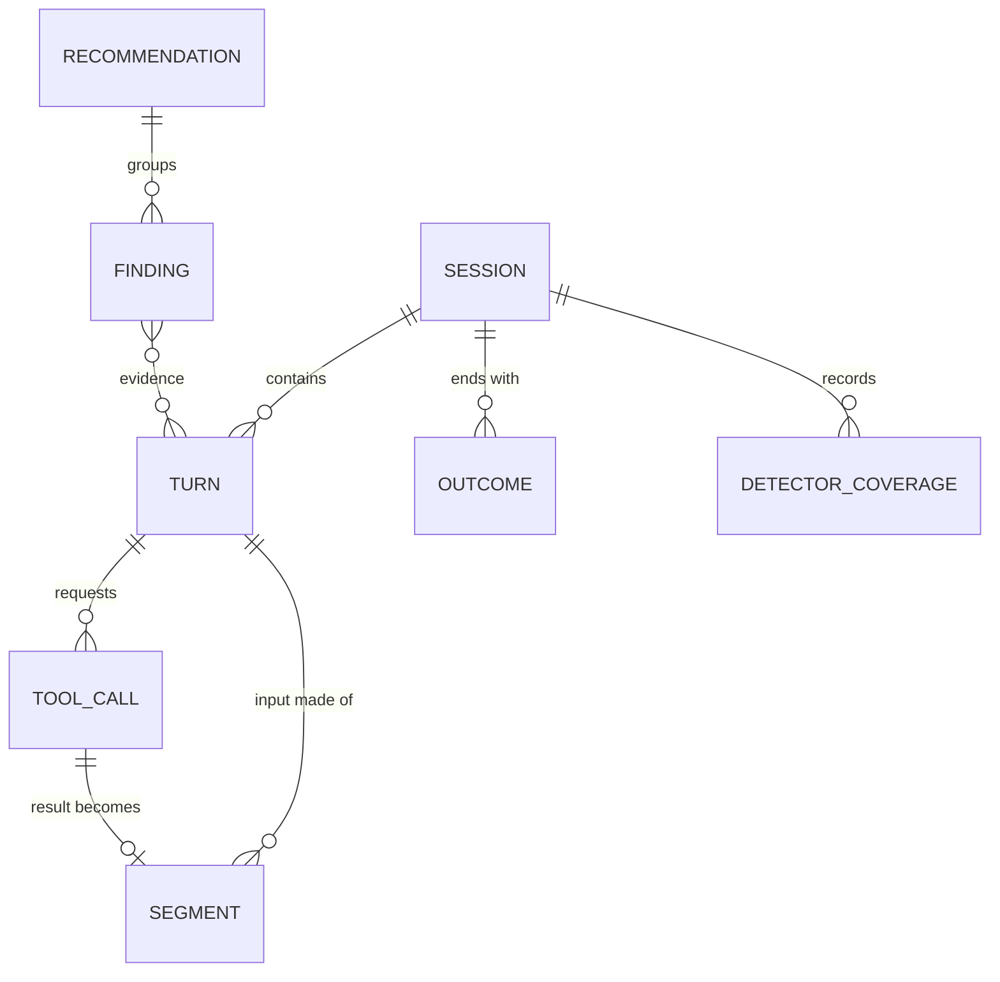

# Data model

One event model for every harness and provider. Taps produce raw envelopes;
the normaliser turns them into these records. Field names are provisional.

## Entities



### Session

One run of a harness, from start to exit (or resume chain).

| Field | Type | Notes |
|---|---|---|
| `session_id` | string | Harness's own id where available, else generated |
| `harness` | enum | `claude-code`, `codex`, `gemini-cli`, `gateway:<name>`, … |
| `harness_version` | string | Detectors are tested per version |
| `developer_id` | string | Pseudonymous; mapping to a person lives only in the team collector |
| `repo` | string | `fp("repo", normalised remote URL)`; display name only if opted in |
| `branch` | string | `fp("branch", name)`; plain only if opted in |
| `started_at` / `ended_at` | timestamp | |
| `resumed_from` | string? | Links resume chains (P09) |
| `capture_source` | enum | `proxy`, `otel`, `transcript`, `gateway` |

### Turn

One model request and its response.

| Field | Type | Notes |
|---|---|---|
| `turn_id` | string | |
| `session_id` | string | |
| `seq` | int | Order within the session |
| `provider` | enum | `anthropic`, `openai`, `google`, … |
| `provider_profile` | string | API surface, e.g. `anthropic-messages`, `openai-responses`; selects parser and cache model ([analyzer.md §10.2](analyzer.md#102-provider-profiles)) |
| `model` | string | As sent |
| `request_at` / `first_token_at` / `completed_at` | timestamp | Latency analysis |
| `status` | int | HTTP status; errors feed P12 |
| `usage.input_uncached` | int | Input billed at the normal input price ([usage normalisation](#usage-normalisation)) |
| `usage.cache_read` | int | Input served from cache |
| `usage.cache_write_5m` | int | Input written to cache with the short lifetime (0 where writes are not billed) |
| `usage.cache_write_1h` | int | Input written to cache with the long lifetime |
| `usage.output` | int | All billed output, including reasoning |
| `usage.reasoning` | int? | Reasoning / thinking tokens, a subset of `output`; null if not reported |
| `fp_version` | string | Fingerprint spec version, e.g. `fp1` ([fingerprinting](#fingerprinting)) |
| `fp_key_id` | string | Identifies the fingerprint key used; codes with different key ids are never compared |
| `exact_prefix_at_breakpoints` | string[] | Exact prefix-hash value at each cache breakpoint |
| `content_prefix_at_messages` | string[] | Content prefix-hash value at each message boundary (used for sessionising) |
| `cost_estimate` | decimal | From the price catalogue |
| `price_catalogue_version` | string | Makes costs reproducible |
| `transform_version` | string? | Set if an actuator changed the request |

### Segment

A typed slice of a turn's input. The unit of fingerprinting.

| Field | Type | Notes |
|---|---|---|
| `segment_id` | string | |
| `turn_id` | string | |
| `position` | int | Order in the request |
| `kind` | enum | `system`, `tool_definitions`, `memory_file`, `history`, `file_read`, `tool_result`, `user_message`, `assistant_message` |
| `source` | string? | Keyed hash of the file path, URL, tool name or MCP server, where known |
| `exact_hash` | string | Keyed hash of the segment exactly as sent ([fingerprinting](#fingerprinting)) |
| `content_hash` | string | Keyed hash of the segment's canonical form |
| `line_hashes` | string[]? | Per-line hashes; memory files, system prompt and user messages only |
| `tokens` | int | Provider tokenizer where available, else an estimate (flagged) |
| `bytes` | int | |
| `cache_breakpoint_after` | bool | Was a cache marker placed after this segment |
| `content` | text? | Only when `capture.content = full`; redacted |

### ToolCall

| Field | Type | Notes |
|---|---|---|
| `tool_call_id` | string | |
| `turn_id` | string | Turn whose response requested it |
| `name` | string | Plain for the harness's built-in tools; `fp("tool", …)` for MCP tools unless opted in |
| `mcp_server` | string? | `fp("mcp", name)` unless opted in |
| `args_fingerprint` | string | For loop detection (P05) |
| `result_segment_id` | string? | Links to the segment carrying the result |
| `is_error` | bool | |
| `duration_ms` | int? | |

### Outcome

Signals collected at or after session end (design §6.3).

| Field | Type |
|---|---|
| `session_id` | string |
| `kind` | `commit`, `pr_opened`, `tests_passed`, `tests_failed`, `user_interrupt`, `user_correction`, `abandoned`, `reverted_24h` |
| `at` | timestamp |
| `value` | json? |

### Finding

Output of a detector. This is the single definition; other docs refer here.

| Field | Type | Notes |
|---|---|---|
| `finding_id` | string | |
| `pattern_id` | string | `P01` … `P18` |
| `detector_version` | string | `id@version`, e.g. `P01@3` |
| `scope` | enum | `turn`, `session`, `repo`, `developer`, `org` |
| `scope_id` | string | Session id, or the repo / developer / org key |
| `evidence` | json | Typed per pattern: turn ids, segment fingerprints, counts. No free text |
| `wasted_tokens` | json | By token class: `input_uncached`, `cache_read`, `cache_write_5m`, `cache_write_1h`, `output` |
| `est_saving` | decimal | Money, from the price catalogue |
| `price_catalogue_version` | string | Makes `est_saving` reproducible |
| `confidence` | float | 0–1 |
| `fidelity` | enum | `transcript` or `wire` ([analyzer.md §5.1](analyzer.md#51-standalone-trimloop-analyse)) |
| `fix_ref` | string | Recommendation template or actuator op that applies |
| `root_cause_key` | string | Groups findings with the same cause |

### DetectorCoverage

Whether each detector ran for a session (or, for aggregates, a repo / org
scope). Lets reports distinguish "no waste found" from "could not check".

| Field | Type | Notes |
|---|---|---|
| `scope_id` | string | Session id, or repo / org key for aggregates |
| `detector` | string | `id@version`, e.g. `P01@3` |
| `status` | enum | `ran`, `reduced`, `not_applicable` |
| `missing_capabilities` | string[] | Why the status is `reduced` or `not_applicable` |
| `profiles` | json | Provider and harness profile ids and versions used |

### Recommendation

Built by the team collector from grouped findings.

| Field | Type |
|---|---|
| `recommendation_id` | string |
| `root_cause_key` | string |
| `title` / `body` | text (rendered from a per-harness template) |
| `patch` | text? (diff for L1 fixes) |
| `est_weekly_saving` | decimal |
| `status` | `open`, `applied`, `dismissed`, `measured` |
| `measured_saving` | decimal? (after/before comparison) |

## Usage normalisation

Every provider reports tokens differently. The normaliser maps each response's
usage onto five classes, and every cost, ratio and saving is computed from
these — never from raw provider fields.

| Class | Meaning |
|---|---|
| `input_uncached` | Input billed at the normal input price |
| `cache_read` | Input served from cache |
| `cache_write_5m`, `cache_write_1h` | Input written to cache, by lifetime; 0 where writes are not billed |
| `output` | All billed output, including reasoning |
| `reasoning` | Reasoning / thinking tokens: a subset of `output`, null if not reported |

Derived: `input_total = input_uncached + cache_read + cache_write_5m +
cache_write_1h`. The cache-hit ratio used by P01 and P02 is
`cache_read ÷ input_total`.

| API surface | `input_uncached` | `cache_read` | `cache_write_*` | `output` | `reasoning` |
|---|---|---|---|---|---|
| Anthropic Messages | `input_tokens` (already excludes cache) | `cache_read_input_tokens` | `cache_creation.ephemeral_5m_input_tokens`, `ephemeral_1h_input_tokens`; if absent, `cache_creation_input_tokens` counts as 5m | `output_tokens` | `output_tokens_details.thinking_tokens` |
| OpenAI Responses | `input_tokens − input_tokens_details.cached_tokens` | `input_tokens_details.cached_tokens` | 0 | `output_tokens` | `output_tokens_details.reasoning_tokens` |
| OpenAI Chat Completions | `prompt_tokens − prompt_tokens_details.cached_tokens` | `prompt_tokens_details.cached_tokens` | 0 | `completion_tokens` | `completion_tokens_details.reasoning_tokens` |
| Gemini | `promptTokenCount − cachedContentTokenCount` | `cachedContentTokenCount` | 0 (managed-cache storage is priced separately) | `candidatesTokenCount + thoughtsTokenCount` | `thoughtsTokenCount` |

Rules:

- Usage is counted **once per provider response** (response or message id).
  Harness logs that repeat it — Claude Code writes the same usage block on
  every line of a multi-block message — are de-duplicated.
- For streamed responses, only the final usage is used.
- The Anthropic row was confirmed against usage blocks in local Claude Code
  transcripts (2026-11-05). The OpenAI and Gemini rows are from provider
  documentation and must be confirmed by recorded fixtures (conformance kit).
- Provider profiles hold these mappings in `usage_fields`; this table is the
  reference the conformance kit tests them against.

## Fingerprinting

### Why fingerprints are needed

Most detectors ask one question over and over: *is this the same as something
seen before?*

| Detector | The comparison |
|---|---|
| P01 cache-prefix churn | Is this turn's request prefix identical to the last one? If not, which segment — and which line — changed? |
| P03 repeated file reads | Is this the same file content read earlier in the session? |
| P06 unused tool definitions | Is this the same tool definition sent on hundreds of requests and never called? |
| P15, P17 repeated work | Did several developers read the same files, or type the same instruction? |
| P18 hot documentation | Is this the same documentation fetched again and again? |
| Sessionising (analyzer §6) | Does this gateway request continue that earlier conversation? |

None of these needs to know *what* the text says, only whether two pieces of
text are equal. The alternatives fail:

| Option | Problem |
|---|---|
| Keep the text | Requests run to tens of thousands of tokens; a month of sessions is gigabytes of source code and secrets. On a server it breaks the privacy promise (ADR 0004); locally it creates a large, sensitive file |
| Keep only sizes and costs | Cannot tell "one 40 KB file read nine times" from "nine different 40 KB files"; most detectors go blind |
| **Fingerprints** | A fixed-size code per segment or line. Equal text gives equal codes, so repeats and changes are visible; the text is not |

Where fingerprints are required, and where they are a choice:

- **Required** wherever data leaves a developer machine — the team collector
  and the gateway sidecar's uploads. They make team-wide findings possible
  without collecting code.
- **A deliberate choice** for local `trimloop analyse`, where the text is
  already on disk in the harness's own logs. Fingerprints keep the local store
  small and fast, keep it free of copies of code and secrets, and let the same
  detectors run unchanged locally and at the collector. When a fix needs the
  text (naming a changed line, drafting a skill), it is read back from the
  harness logs on that machine (`content.local`).

### Specification

The single specification. `pkg/fingerprint` (Go) implements it; the Python
plugin implements it only in remote mode (ADR 0006). Both must pass the shared
vectors in `pkg/fingerprint/testdata/vectors.json`. Every turn records the spec
version (`fp_version`, currently `fp1`) so hashes made under different rules
are never compared.

**Hash function.** HMAC-SHA-256 with the organisation's **fingerprint key**,
hex-encoded ([ADR 0011](adr/0011-keyed-fingerprints.md)). Every input is
prefixed with a context label and a zero byte, so a hash made for one purpose
can never equal a hash made for another:

```text
fp(label, data) = HMAC-SHA-256(fingerprint_key, label ‖ 0x00 ‖ data)
labels: seg.exact, seg.content, line, path, url, repo, branch, tool, mcp
```

Every turn records `fp_key_id`, a short identifier derived from the key
(`fp("key-id", "")`, first 8 hex characters), so codes made with different
keys are never compared.

**Segments.** A request is split into ordered segments, one per:

- system block (each element of `system`, or the whole system string);
- tool definition (each element of `tools`);
- message content block (text, image, thinking, tool use, tool result), in
  message order;
- injected context: text a harness inserts inside user messages that its
  profile marks (for example Claude Code's `<system-reminder>` blocks) is split
  out of the surrounding block as its own segment, kind `injected_context`.

Segments never split a content block in any other way.

**Cache markers.** `cache_control` and equivalent fields are removed before
hashing and recorded as `cache_breakpoint_after`. They change where a provider
caches, not what.

**Two hashes per segment.**

| Hash | Input | Used for |
|---|---|---|
| `exact_hash` | The segment's bytes exactly as serialised in the request, minus cache markers | Cache analysis (P01, P02, P09): any byte change breaks a provider cache, so nothing is normalised away |
| `content_hash` | The segment's canonical form (below) | Content identity regardless of formatting (P03, P15, P17, P18) and sessionising |

**Canonical form.**

- JSON values: RFC 8785 JSON Canonicalization Scheme (sorted keys, no
  insignificant whitespace, canonical numbers).
- Text: Unicode NFC; CRLF and CR become LF; nothing else changes (whitespace
  inside lines can matter in code).
- Tool results and file reads: the payload only, with any wrapper the harness
  profile declares (such as line-number prefixes) removed, so the same file
  read twice has the same content hash.
- Assistant output: the response's content blocks converted to the message
  form the harness sends back on the next turn, then canonicalised. So the
  content hash of turn *n*'s output equals that of the matching history segment
  in request *n+1* — which sessionising relies on.

**Prefix hashes.** Two rolling chains over the ordered segments:
`P₀ = fp("prefix", "")`, `Pᵢ = fp("prefix", Pᵢ₋₁ ‖ hᵢ)`, where `hᵢ` is the segment's
exact hash (exact chain) or content hash (content chain). A turn stores the
exact chain at each cache breakpoint and the content chain at each message
boundary.

**Line hashes.** For memory files, the system prompt and user messages only:
`fp("line", …)` of each canonical line, empty lines skipped, in order, at most 2,000
per segment. They let P01 name the line that changed and P17 find repeated
instructions without content leaving the machine. Tool results get sizes, not
line hashes.

**Order relative to redaction.** Hashes are computed over the original text,
before redaction, so a random ID that changes every turn still shows up as
churn (P01). Redaction governs only text that is stored
(`capture.content = full`) or rendered. Because hashes are keyed, nobody
without the fingerprint key can confirm a guessed secret, path or line from
them.

## What leaves the machine

In the default `hashes` capture mode, the team collector receives:

- Session, Turn, ToolCall, Outcome, Finding and DetectorCoverage records.
- Segments **without** `content`: keyed exact, content and line hashes, sizes,
  kinds.
- Names as keyed hashes: file paths, URLs, repo, branch, MCP server and MCP
  tool names. Each can be sent in plain text only if the organisation opts in
  for that field (`privacy.plain_names`). The harness's own built-in tool names
  (for example `Read`, `Bash`) are sent in plain text; they reveal nothing about
  the customer.

It never receives prompt text, file contents, tool output, auth headers or the
fingerprint key. What it can still see — counts, sizes, timing, costs, and
which sessions share an (unnamed) item — is listed in
[ADR 0011](adr/0011-keyed-fingerprints.md#what-it-protects-and-what-it-does-not).

## Storage

| Where | Engine | Retention (default) |
|---|---|---|
| Developer machine | DuckDB file `~/.trimloop/trimloop.duckdb`, encrypted at rest | 30 days of events; findings kept 1 year |
| Team collector | ClickHouse (events, findings), Postgres (recommendations, policies) | 13 months |

Schema versions, migrations and backups for the local DuckDB file are
described in [packaging.md](packaging.md#bundled-components).

## Price catalogue

A versioned YAML file of per-model prices by token class (input, output, cache
write by TTL, cache read) with effective dates. Shipped with each release and
overridable for negotiated rates. Every cost figure records the catalogue
version used.
