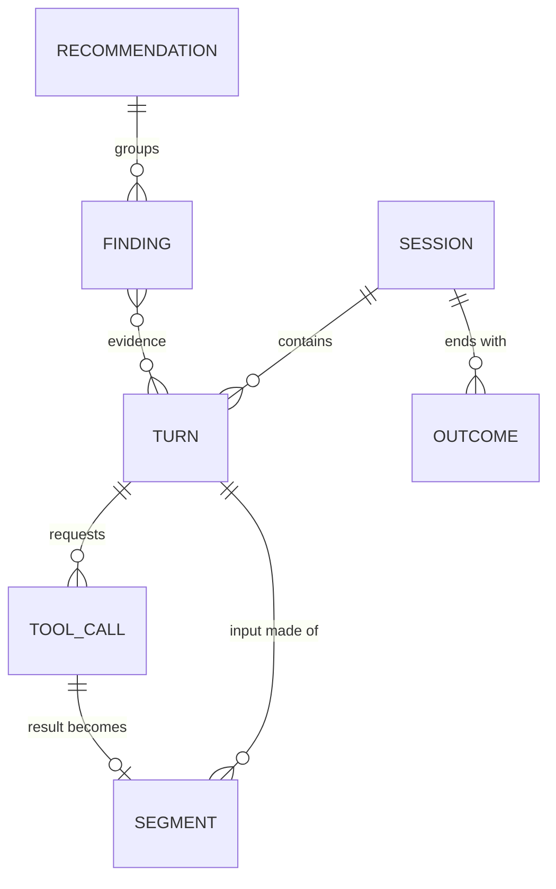

# Data model

One event model for every harness and provider. Taps produce raw envelopes;
the normaliser turns them into these records. Field names are provisional.

## Entities

### Session

One run of a harness, from start to exit (or resume chain).

| Field | Type | Notes |
|---|---|---|
| `session_id` | string | Harness's own id where available, else generated |
| `harness` | enum | `claude-code`, `codex`, `gemini-cli`, `gateway:<name>`, … |
| `harness_version` | string | Detectors are tested per version |
| `developer_id` | string | Pseudonymous; mapping to a person lives only in the team collector |
| `repo` | string | Normalised git remote URL hash + display name |
| `branch` | string | |
| `started_at` / `ended_at` | timestamp | |
| `resumed_from` | string? | Links resume chains (P09) |
| `capture_source` | enum | `proxy`, `otel`, `transcript`, `gateway` |

### Turn

One model request and its response.

| Field | Type | Notes |
|---|---|---|
| `turn_id` | string | |
| `session_id` | string | |
| `seq` | int | Order within the session |
| `provider` | enum | `anthropic`, `openai`, `google`, … |
| `model` | string | As sent |
| `request_at` / `first_token_at` / `completed_at` | timestamp | Latency analysis |
| `status` | int | HTTP status; errors feed P12 |
| `usage.input_tokens` | int | Uncached input |
| `usage.cache_write_tokens` | int | Anthropic: `cache_creation_input_tokens` |
| `usage.cache_read_tokens` | int | Anthropic: `cache_read_input_tokens`; OpenAI: `cached_tokens` in the usage details |
| `usage.output_tokens` | int | |
| `usage.reasoning_tokens` | int? | Where reported |
| `prefix_fingerprints` | string[] | Ordered segment fingerprints up to the last cache breakpoint |
| `cost_estimate` | decimal | From the price catalogue |
| `price_catalogue_version` | string | Makes costs reproducible |
| `transform_version` | string? | Set if an actuator changed the request |

### Segment

A typed slice of a turn's input. The unit of fingerprinting.

| Field | Type | Notes |
|---|---|---|
| `segment_id` | string | |
| `turn_id` | string | |
| `position` | int | Order in the request |
| `kind` | enum | `system`, `tool_definitions`, `memory_file`, `history`, `file_read`, `tool_result`, `user_message`, `assistant_message` |
| `source` | string? | File path, tool name or MCP server, where known |
| `fingerprint` | string | SHA-256 of normalised text |
| `chunk_hashes` | string[] | Rolling-hash chunks for near-duplicate detection |
| `tokens` | int | Provider tokenizer where available, else an estimate (flagged) |
| `bytes` | int | |
| `cache_breakpoint_after` | bool | Was a cache marker placed after this segment |
| `content` | text? | Only when `capture.content = full`; redacted |

### ToolCall

| Field | Type | Notes |
|---|---|---|
| `tool_call_id` | string | |
| `turn_id` | string | Turn whose response requested it |
| `name` | string | |
| `mcp_server` | string? | |
| `args_fingerprint` | string | For loop detection (P05) |
| `result_segment_id` | string? | Links to the segment carrying the result |
| `is_error` | bool | |
| `duration_ms` | int? | |

### Outcome

Signals collected at or after session end (design §6.3).

| Field | Type |
|---|---|
| `session_id` | string |
| `kind` | `commit`, `pr_opened`, `tests_passed`, `tests_failed`, `user_interrupt`, `user_correction`, `abandoned`, `reverted_24h` |
| `at` | timestamp |
| `value` | json? |

### Finding

Output of a detector (design §6.1).

| Field | Type |
|---|---|
| `finding_id` | string |
| `pattern_id` | string (e.g. `P01`) |
| `detector_version` | string |
| `scope` | `turn` / `session` / `repo` / `developer` / `org` |
| `evidence` | json (ids, fingerprints, counts) |
| `wasted_tokens` | json by token class |
| `est_saving` | decimal |
| `confidence` | float 0–1 |
| `root_cause_key` | string (groups findings with the same cause) |

### Recommendation

Built by the team collector from grouped findings.

| Field | Type |
|---|---|
| `recommendation_id` | string |
| `root_cause_key` | string |
| `title` / `body` | text (rendered from a per-harness template) |
| `patch` | text? (diff for L1 fixes) |
| `est_weekly_saving` | decimal |
| `status` | `open`, `applied`, `dismissed`, `measured` |
| `measured_saving` | decimal? (after/before comparison) |

## What leaves the machine

In the default `hashes` capture mode, the team collector receives:

- Session, Turn, ToolCall, Outcome, Finding records.
- Segments **without** `content`: fingerprints, chunk hashes, sizes, kinds.
  The `source` path is hashed unless the repo opts in to plain paths.

It never receives prompt text, file contents, tool output, or auth headers.

## Storage

| Where | Engine | Retention (default) |
|---|---|---|
| Developer machine | DuckDB file `~/.trimloop/trimloop.duckdb`, encrypted at rest | 30 days of events; findings kept 1 year |
| Team collector | ClickHouse (events, findings), Postgres (recommendations, policies) | 13 months |

## Price catalogue

A versioned YAML file of per-model prices by token class (input, output, cache
write by TTL, cache read) with effective dates. Shipped with each release and
overridable for negotiated rates. Every cost figure records the catalogue
version used.
