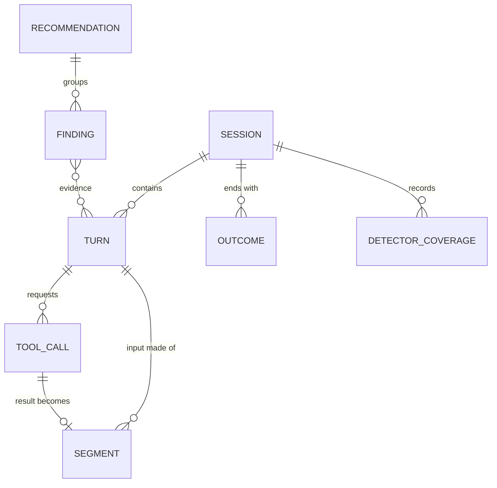

# Data model

One event model for every harness and provider. Taps produce raw envelopes;
the normaliser turns them into these records. Field names are provisional.

Most of this document is the **target model**: the store, segments,
fingerprints and the team collector's records are not built. What the M0
prototype does build is collected in the next section, and marked
"**Built:**" where it touches a target field.

## Built in the prototype

The prototype keeps no store. It reads Claude Code's logs into memory on
every run, and keeps only weekly figures between runs. How each figure is
worked out is in [measurements.md](measurements.md).

- **Report JSON** (`trimloop --format json`, layout `trimloop-report/1`;
  adding a field keeps the version, removing or changing one bumps it).
  It holds the figures behind every finding, the plan (`plan`) and usage
  limits (`usage_limits`: hits, readings, the measured rates) for
  subscribers, each action's `weekly_limit_share` where measured
  ([ADR 0048](adr/0048-usage-limits-for-subscribers.md)); model switches
  (`p01_model_switches`), failed requests (`p12_failures`), tool inputs
  (`tool_inputs`), unused app servers, `start_cost`, `when` and `retention`
  ([ADR 0050](adr/0050-second-gap-analysis-findings.md)); the price
  catalogue version used, the build that made it (`trimloop_version`) and, for a `--since`
  run, the date it starts from (`read.since`). Each recommendation carries `pattern`, `title`, `finding` (a
  sentence), `saving` (an upper bound, "up to"), `likely` (a likelier
  figure, worked out only where `estimated` is true; then 0 is an estimate
  of nothing, and `nothing` says why), `likely_note` (how it was estimated),
  `likely_low` and `likely_high` (a range, where the likely figure rests on
  a measured size that varies), the `primary` fix and `alternatives`.
  Actions are ranked by the upper bound, the one figure every
  recommendation has, except that a card estimated to save nothing goes
  last ([ADR 0053](adr/0053-projects-by-conversation-and-ranking.md);
  [ADR 0032](adr/0032-readable-reports.md),
  [ADR 0045](adr/0045-m0-measurement-method.md)).
- **Week**, the history file: below.
- **Limit readings** (`~/.trimloop/limits.jsonl`, one `limits-<id>.jsonl`
  per other `CLAUDE_CONFIG_DIR`): one JSON line per change in a
  subscriber's usage limits, as the status line saw them: `time`, and for
  `five_hour` and `seven_day` the percentage `used` and `resets_at` (Unix
  seconds). Numbers only.
- **File names**: per-session nudge state is named by Claude Code's session
  id (`~/.trimloop/live/<session>.json`), and history and limit files for
  another `CLAUDE_CONFIG_DIR` by the first 8 hex digits of a SHA-256 of the
  folder's path. These names never leave the machine; the keyed-hash rule
  ([ADR 0004](adr/0004-local-first-hashes-only.md),
  [ADR 0011](adr/0011-keyed-fingerprints.md)) is for what does.
- **Turn fields read from the logs**: a yes/no form of `origin`, and
  `effort` (see [Turn](#turn)); the session `title`, shown in local reports
  only.
- **Usage**: the Anthropic row of [usage normalisation](#usage-normalisation)
  and its de-duplication rules.
- **Prices**: a Go table, not the YAML file ([price catalogue](#price-catalogue)).

### Week (history file)

Figures per calendar week, kept between runs in `~/.trimloop/history.json`
(one `history-<id>.json` per other `CLAUDE_CONFIG_DIR` folder)
so a fix can be compared before and after once the harness has deleted the
logs ([ADR 0033](adr/0033-reconciliation-history-standing-context.md)).
Numbers only: no names, titles, paths or session ids.

| Field | Type | Notes |
|---|---|---|
| `week` | date | The Monday the week starts, local time |
| `spend` / `turns` | number / int | |
| `large_context` | number | Input cost of turns over the P19 threshold |
| `sub_agents` | number | Spend in sub-agents |
| `pause_rewrite` | number | Cache re-writes after long breaks the user took, in main sessions (P09; analysis version 4; a stored week from an earlier version counted other waits too, and reports mark it as older) |
| `tool_output` | number | Carried cost of tool output added that week (P04; since version 4, carried history on rebuilt-cache turns is priced as a write) |
| `file_views` / `rereads` | int | File views, and those that re-read the same part of a file not changed since (analysis version 8; earlier versions counted any view of a file already viewed; version 9 follows a `cd` before a shell view and counts every file of a multi-file view) |
| `short_waits` | number | What a 5-minute cache expiring after 5–60 minute waits cost, against the cache still there (P02; added in version 5, [ADR 0043](adr/0043-weekly-trend-for-new-findings.md); this meaning from version 6, [ADR 0045](adr/0045-m0-measurement-method.md)). A week stored before version 5 has none: reports show a dash |
| `top_effort` | number | Output cost of xhigh and max turns: the spend the P14 card is about, not its saving (version 5) |
| `older_models` | number | Main-session spend on a model with a newer, cheaper version or a cheaper tier, shown as "cheaper choice": the spend the P13 cards are about, not their saving (version 5) |
| `limit_hits` | int | Requests Claude Code refused because a subscription usage limit was reached (version 7, [ADR 0048](adr/0048-usage-limits-for-subscribers.md)) |
| `compactions` | int | |
| `prices` | string | Price catalogue version the figures used |
| `analysis` | int | Analysis version that worked the figures out. A week the logs still hold replaces the stored copy, except a week Claude Code may have partly deleted (up to the week of the oldest log on disk): there the stored copy stays when it has more turns and counted them the same way (version 2 on) ([ADR 0045](adr/0045-m0-measurement-method.md)) |
| `kept` | bool | Shown, not stored: the week's figures came from the history file, because its logs are gone or the stored copy was fuller |
| `kept_why` | string? | Shown, not stored: why a kept week came from the history file: "logs deleted", or "logs partly deleted, stored copy fuller" |

## Entities

Target model; not built except where marked **Built:**.



### Session

One run of a harness, from start to exit (or resume chain).

| Field | Type | Notes |
|---|---|---|
| `session_id` | string | Harness's own id where available, else generated |
| `harness` | enum | `claude-code`, `codex`, `gemini-cli`, `gateway:<name>`, … |
| `harness_version` | string | Detectors are tested per version |
| `developer_id` | string | `fp("developer", …)`; the mapping to a person stays on the customer side ([ADR 0024](adr/0024-developer-identity-and-key-handling.md)) |
| `repo` | string | `fp("repo", normalised remote URL)`; display name only if opted in |
| `branch` | string | `fp("branch", name)`; plain only if opted in |
| `started_at` / `ended_at` | timestamp | |
| `resumed_from` | string? | Links resume chains (P09) |
| `kind` | enum | `main`, `subagent` or `auxiliary` ([ADR 0012](adr/0012-gateway-sessions-and-parity.md)) |
| `parent_session_id` | string? | Parent of a `subagent` session |
| `entrypoint` | string? | How the harness was started: `cli`, `desktop`, `ide`, `sdk` ([ADR 0028](adr/0028-harness-recorded-signals.md)) |
| `agent_type` / `spawn_depth` | string? / int? | For sub-agents, from the harness's agent record or `harness.attribution`; `fp("agent", …)` unless opted in |
| `harness_cost` | json? | The harness's own per-model usage and cost for the session (`harness.cost_record`); reconciled against Trimloop's totals |
| `lines_added` / `lines_removed` | int? | From the harness record (`outcome.lines_changed`) |
| `capture_source` | enum | `proxy`, `otel`, `transcript`, `gateway` |
| `title` | string? | The harness's or user's title for the session. Generated titles summarise the conversation, so this is content: shown in local reports only, never stored or sent. **Built:** read from the logs for local reports ([ADR 0032](adr/0032-readable-reports.md)) |

### Turn

One model request and its response.

| Field | Type | Notes |
|---|---|---|
| `turn_id` | string | |
| `session_id` | string | |
| `seq` | int | Order within the session |
| `provider` | enum | `anthropic`, `openai`, `google`, … |
| `provider_request_id` | string? | Provider or gateway request id, where available — de-duplicates the same turn seen by two taps |
| `response_id` | string? | Provider response or message id — usage is counted once per response |
| `origin` | enum? | `human`, `automation`, `notification`, `schedule`, `continuation` (`session.origin`). **Built:** only as a yes/no: the prototype's `Prompted` is true when the user sent a message, answered Claude's question or decided on a permission since the previous turn; the text is not kept ([ADR 0045](adr/0045-m0-measurement-method.md)) |
| `effort` | string? | Reasoning effort or budget requested (`request.effort`). **Built:** the prototype reads Claude Code's `effort` on each turn (P14, [ADR 0042](adr/0042-p02-p14-and-main-session-models.md)) |
| `repo` | string? | Where the turn ran, when it differs from the session's: sessions can move between repos ([ADR 0031](adr/0031-m0-order-from-measured-spend.md)); keyed like Session `repo` |
| `attribution` | json? | Skill, plugin, MCP server and agent type the harness names as the turn's cause (`harness.attribution`); keyed with `skill`, `plugin`, `mcp` and `agent` unless opted in |
| `requested_model` | string? | Model asked for, where it differs from `model` (fallbacks) |
| `stop_reason` | string? | As reported by the provider |
| `shape_hash` | string? | Harness identifier for the system prompt and tool list (`request.shape_hash`) |
| `cache_ttl_requested` | string? | Cache lifetime asked for, e.g. `5m`, `1h` |
| `history_keep` | int? | Messages kept from the previous request when the harness edited history |
| `duration_ms` | int? | Wall-clock turn duration (`timing.turn_duration`) |
| `server_tool_requests` | json? | Server-side tool requests by kind (`usage.server_tools`), priced per request |
| `provider_profile` | string | API surface, e.g. `anthropic-messages`, `openai-responses`; selects parser and cache model ([analyzer.md §10.2](analyzer.md#102-provider-profiles)) |
| `model` | string | As sent |
| `request_at` / `first_token_at` / `completed_at` | timestamp | Latency analysis |
| `status` | int | HTTP status; errors feed P12 |
| `usage.input_uncached` | int | Input billed at the normal input price ([usage normalisation](#usage-normalisation)) |
| `usage.cache_read` | int | Input served from cache |
| `usage.cache_write_5m` | int | Input written to cache with the short lifetime (0 where writes are not billed) |
| `usage.cache_write_1h` | int | Input written to cache with the long lifetime |
| `usage.output` | int | All billed output, including reasoning |
| `usage.reasoning` | int? | Reasoning / thinking tokens, a subset of `output`; null if not reported |
| `fp_version` | string | Fingerprint spec version, e.g. `fp1` ([fingerprinting](#fingerprinting)) |
| `fp_key_id` | string | Identifies the fingerprint key used; codes with different key ids are never compared |
| `segment_refs` | id[] | Ordered references to the turn's segments ([ADR 0017](adr/0017-content-addressed-segments.md)) |
| `shared_prefix_len` | int | Segments shared with the session's previous turn |
| `breakpoints` | int[] | Positions in `segment_refs` after which a cache marker was placed (a property of the request, not the segment) |
| `exact_prefix_new` | string[] | Exact prefix-chain values for segments beyond the shared prefix, at cache breakpoints |
| `content_prefix_new` | string[] | Content prefix-chain values beyond the shared prefix, at message boundaries (sessionising) |
| `history_edit_at` | int? | Segment index where this request's history diverges from the previous turn's (clearing, compaction, truncation) |
| `cost_estimate` | decimal | From the price catalogue |
| `price_catalogue_version` | string | Makes costs reproducible |
| `transform_version` | string? | Set if an actuator changed the request |

### Segment

A typed slice of a turn's input. The unit of fingerprinting. Stored **once**,
keyed by `(fp_key_id, exact_hash)`, and referenced by every turn that contains
it ([ADR 0017](adr/0017-content-addressed-segments.md)).

| Field | Type | Notes |
|---|---|---|
| `segment_id` | string | Compact id; order within a request comes from the turn's `segment_refs` |
| `fp_key_id` | string | Key the hashes were made with |
| `kind` | enum | See the segment table in [fingerprinting](#specification) |
| `source_kind` | enum? | For `tool_result`: `file`, `url`, `command`, `mcp`, `other` |
| `source` | string? | Keyed hash of the file path, URL, tool name or MCP server, where known |
| `exact_hash` | string? | Keyed hash of the segment's order-preserving compact JSON ([fingerprinting](#fingerprinting)) |
| `content_hash` | string | Keyed hash of the segment's canonical form |
| `line_hashes` | string[]? | Per-line hashes; memory files, system prompt and user messages only |
| `tokens` | int | Provider tokenizer where available, else an estimate (flagged) |
| `bytes` | int | |
| `content` | text? | Only when `capture.content = full`; redacted |

### ToolCall

| Field | Type | Notes |
|---|---|---|
| `tool_call_id` | string | |
| `turn_id` | string | Turn whose response requested it |
| `name` | string | Plain for the harness's built-in tools; `fp("tool", …)` for MCP tools unless opted in |
| `mcp_server` | string? | `fp("mcp", name)` unless opted in |
| `args_fingerprint` | string | For loop detection (P05) |
| `result_segment_id` | string? | Links to the segment carrying the result |
| `is_error` | bool | |
| `duration_ms` | int? | |

### Outcome

Signals collected at or after session end (design §6.3).

| Field | Type |
|---|---|
| `session_id` | string |
| `kind` | `commit`, `pr_opened`, `tests_passed`, `tests_failed`, `user_interrupt`, `user_correction`, `abandoned`, `reverted_24h` |
| `at` | timestamp |
| `value` | json? |

### Finding

Output of a detector. This is the single definition; other docs refer here.

| Field | Type | Notes |
|---|---|---|
| `finding_id` | string | |
| `pattern_id` | string | `P01` … `P19` |
| `detector_version` | string | `id@version`, e.g. `P01@3` |
| `scope` | enum | `turn`, `session`, `repo`, `gateway_key`, `developer`, `org` (`gateway_key` groups by key alias and harness where repo is unknown) |
| `scope_id` | string | Session id, or the repo / gateway-key / developer / org key |
| `evidence` | json | Typed per pattern: turn ids, segment fingerprints, counts. No free text |
| `wasted_tokens` | json | By token class: `input_uncached`, `cache_read`, `cache_write_5m`, `cache_write_1h`, `output` |
| `est_saving` | decimal | Upper bound ("up to"), money from the price catalogue. Findings and recommendations are ranked by it, the one figure every finding has ([ADR 0032](adr/0032-readable-reports.md), [ADR 0045](adr/0045-m0-measurement-method.md)) |
| `likely_saving` | decimal? | A likelier saving, where the fix can be replayed against the measured sessions; null if not estimated. Never above `est_saving` |
| `likely_low` / `likely_high` | decimal? | A range around `likely_saving`, where it rests on a measured size that varies (for example the size after a compaction); null otherwise |
| `price_catalogue_version` | string | Makes the savings reproducible |
| `confidence` | float | 0–1 |
| `fidelity` | enum | `transcript`, `gateway` (canonical re-serialisation of the provider-bound body) or `wire` (bytes as sent, local proxy) |
| `fix_ref` | string | Recommendation template or actuator op that applies |
| `root_cause_key` | string | Groups findings with the same cause |

### DetectorCoverage

Whether each detector ran for a session (or, for aggregates, a repo / org
scope). Lets reports distinguish "no waste found" from "could not check".

| Field | Type | Notes |
|---|---|---|
| `scope_id` | string | Session id, or repo / gateway-key / developer / org key for aggregates |
| `detector` | string | `id@version`, e.g. `P01@3` |
| `status` | enum | `ran`, `reduced`, `not_applicable` |
| `missing_capabilities` | string[] | Why the status is `reduced` or `not_applicable` |
| `profiles` | json | Provider and harness profile ids and versions used |

### Recommendation

Built by the team collector from grouped findings. It holds no content: the
exact change is rendered on a developer machine (design §6.2).

| Field | Type |
|---|---|
| `recommendation_id` | string |
| `root_cause_key` | string |
| `template_id` | string (per-harness fix template) |
| `fix_kind` | `source`, `structure`, `enforce`, `cap`, `advise`, `trim` ([ADR 0030](adr/0030-how-fixes-are-chosen.md)) |
| `alternatives` | json (up to two alternative fixes of other kinds: kind and template id) |
| `params` | json (keyed hashes and counts the template needs, e.g. segment and line hashes) |
| `title` / `body` | text (rendered from the template without content) |
| `est_weekly_saving` | decimal (upper bound; recommendations are ranked by it) |
| `likely_weekly_saving` | decimal? (likely figure, where the findings have one) |
| `likely_weekly_low` / `likely_weekly_high` | decimal? (range around the likely figure, where it has one) |
| `status` | `open`, `applied`, `dismissed`, `measured`, `escalated`, `rolled_back` |
| `measured_saving` | decimal? (after/before comparison) |
| `side_effects` | json? (re-runs, turns per session, tool errors, extra reads: before and after) |

## Usage normalisation

Every provider reports tokens differently. The normaliser maps each response's
usage onto five classes, and every cost, ratio and saving is computed from
these — never from raw provider fields.

| Class | Meaning |
|---|---|
| `input_uncached` | Input billed at the normal input price |
| `cache_read` | Input served from cache |
| `cache_write_5m`, `cache_write_1h` | Input written to cache, by lifetime; 0 where writes are not billed |
| `output` | All billed output, including reasoning |
| `reasoning` | Reasoning / thinking tokens: a subset of `output`, null if not reported |

Derived: `input_total = input_uncached + cache_read + cache_write_5m +
cache_write_1h`. The cache-hit ratio used by P01 and P02 is
`cache_read ÷ input_total`.

| API surface | `input_uncached` | `cache_read` | `cache_write_*` | `output` | `reasoning` |
|---|---|---|---|---|---|
| Anthropic Messages | `input_tokens` (already excludes cache) | `cache_read_input_tokens` | `cache_creation.ephemeral_5m_input_tokens`, `ephemeral_1h_input_tokens`; writes `cache_creation_input_tokens` counts beyond that split (all of it, when the split is absent) count as 5m | `output_tokens` | `output_tokens_details.thinking_tokens` |
| OpenAI Responses | `input_tokens − input_tokens_details.cached_tokens` | `input_tokens_details.cached_tokens` | 0 | `output_tokens` | `output_tokens_details.reasoning_tokens` |
| OpenAI Chat Completions | `prompt_tokens − prompt_tokens_details.cached_tokens` | `prompt_tokens_details.cached_tokens` | 0 | `completion_tokens` | `completion_tokens_details.reasoning_tokens` |
| Gemini | `promptTokenCount − cachedContentTokenCount` | `cachedContentTokenCount` | 0 (managed-cache storage is priced separately) | `candidatesTokenCount + thoughtsTokenCount` | `thoughtsTokenCount` |

**Built:** the prototype applies the Anthropic row (`pkg/normalize/anthropic`)
and the first rule below, de-duplication.

Rules:

- Usage is counted **once per provider response** (response or message id).
  Harness logs that repeat it — Claude Code writes a usage block on every
  line of a multi-block message — are de-duplicated, across all logs a run
  reads, not per log ([ADR 0026](adr/0026-usage-dedup-across-logs.md)).
  Within a log, the fullest of those blocks counts: an early line can carry
  a partial output count ([ADR 0045](adr/0045-m0-measurement-method.md)).
- For streamed responses, only the final usage is used.
- Where the harness keeps its own cost record (`harness.cost_record`), calls
  it billed but did not log as turns — Claude Code's title generation, for
  example — are added as `auxiliary` turns with the harness's usage and
  model. The reader's acceptance test is **reconciliation**: per session and
  token class, Trimloop's totals match the harness record within 2 %,
  auxiliary calls included; the report shows unobserved spend where they do
  not ([ADR 0028](adr/0028-harness-recorded-signals.md)). Not built in M0:
  the prototype has no auxiliary turns, and reports the gap (about 13 %)
  instead of passing the test ([ADR 0045](adr/0045-m0-measurement-method.md)).
- The Anthropic row was confirmed against usage blocks in local Claude Code
  transcripts (2026-11-05). The OpenAI and Gemini rows are from provider
  documentation and must be confirmed by recorded fixtures (conformance kit).
- Provider profiles hold these mappings in `usage_fields`; this table is the
  reference the conformance kit tests them against.

## Fingerprinting

### Why fingerprints are needed

Most detectors ask one question over and over: *is this the same as something
seen before?*

| Detector | The comparison |
|---|---|
| P01 cache-prefix churn | Is this turn's request prefix identical to the last one? If not, which segment — and which line — changed? |
| P03 repeated file reads | Is this the same file content read earlier in the session? |
| P06 unused tool definitions | Is this the same tool definition sent on hundreds of requests and never called? |
| P15, P17 repeated work | Did several developers read the same files, or type the same instruction? |
| P18 hot documentation | Is this the same documentation fetched again and again? |
| Sessionising (analyzer §6) | Does this gateway request continue that earlier conversation? |

None of these needs to know *what* the text says, only whether two pieces of
text are equal. The alternatives fail:

| Option | Problem |
|---|---|
| Keep the text | Requests run to tens of thousands of tokens; a month of sessions is gigabytes of source code and secrets. On a server it breaks the privacy promise (ADR 0004); locally it creates a large, sensitive file |
| Keep only sizes and costs | Cannot tell "one 40 KB file read nine times" from "nine different 40 KB files"; most detectors go blind |
| **Fingerprints** | A fixed-size code per segment or line. Equal text gives equal codes, so repeats and changes are visible; the text is not |

Where fingerprints are required, and where they are a choice:

- **Required** wherever data leaves a developer machine — the team collector
  and the gateway sidecar's uploads. They make team-wide findings possible
  without collecting code.
- **A deliberate choice** for local `trimloop analyse`, where the text is
  already on disk in the harness's own logs. Fingerprints keep the local store
  small and fast, keep it free of copies of code and secrets, and let the same
  detectors run unchanged locally and at the collector. When a fix needs the
  text (naming a changed line, drafting a skill), it is read back from the
  harness logs on that machine (`content.local`).

### Specification

The single specification. `pkg/fingerprint` (Go) will implement it; it is
not built yet (the prototype hashes nothing it stores). The Python plugin
implements it only in remote mode (ADR 0006). Both must pass the shared
vectors in `pkg/fingerprint/testdata/vectors.json`. Every turn records the spec
version (`fp_version`, currently `fp1`) so hashes made under different rules
are never compared.

**Hash function.** HMAC-SHA-256 with the organisation's **fingerprint key**
([ADR 0011](adr/0011-keyed-fingerprints.md)). Every input is prefixed with a
context label and a zero byte, so a hash made for one purpose can never equal
a hash made for another:

```text
fp(label, data) = HMAC-SHA-256(fingerprint_key, label ‖ 0x00 ‖ data)
```

- `label` is the ASCII label from the registry below; `data` is UTF-8 text or
  raw bytes as the label says.
- `fp` returns **32 raw bytes**. Everything that combines hashes (prefix
  chains) works on raw bytes. Hashes are hex-encoded (lower case, 64
  characters) only when stored or sent.

Label registry — no other labels may be used:

| Label | Input | Used for |
|---|---|---|
| `seg.exact` | Segment's order-preserving compact JSON, cache markers removed ([ADR 0025](adr/0025-exact-hash-order-preserving-json.md)) | `exact_hash` |
| `seg.content` | Segment canonical form | `content_hash` |
| `prefix.exact` | Previous chain value (32 bytes) ‖ segment `exact_hash` (32 bytes) | Exact prefix chain |
| `prefix.content` | Previous chain value ‖ segment `content_hash` | Content prefix chain |
| `line` | One canonical line | `line_hashes` |
| `args` | Tool-call input, canonical JSON | `args_fingerprint` (P05) |
| `args.template` | Tool-call input with values replaced by their JSON types | Argument templates (P16) |
| `cmd.shape` | Shell command shape: program, subcommand and output-size flags, derived locally | Command-shape groups (P04) |
| `path` | Normalised file path | `source`, P03, P15 |
| `url` | Normalised URL | `source`, P18 |
| `repo` | Normalised git remote URL | Session `repo` |
| `branch` | Branch name | Session `branch` |
| `tool` | MCP tool name | Tool-call `name` |
| `mcp` | MCP server name | `mcp_server` |
| `root` | Harness id ‖ 0x00 ‖ principal ‖ 0x00 ‖ content hash of the first `user_text` segment (system, tool, memory-file and injected segments excluded) | Fallback session anchor ([ADR 0020](adr/0020-session-identity.md)) |
| `bucket` | Session anchor ‖ 0x00 ‖ experiment id (UTF-8 `<op>@<policy_version>`) | Canary bucket ([ADR 0018](adr/0018-rollout-refinements.md), [ADR 0020](adr/0020-session-identity.md)) |
| `developer` | Stable developer identity (git email, else OS user ‖ machine id) | `developer_id` ([ADR 0024](adr/0024-developer-identity-and-key-handling.md)) |
| `alias` | Gateway key alias or team name | Principal, gateway grouping |
| `diff` | Normalised unified diff of the working tree (local only) | Diff progress (P05, P11) |
| `skill` | Skill name | Skill attribution, skill listings |
| `plugin` | Plugin name | Plugin attribution |
| `agent` | Agent type name (custom agents can carry private names) | Session `agent_type`, turn attribution |
| `key-id` | Empty | `fp_key_id`: first 8 hex characters |

A **request fingerprint** (P12) is the turn's final exact prefix-chain value;
it needs no label of its own.

**Normalisation before hashing names.**

| Name | Rule |
|---|---|
| `path` | Inside the repo: repo-relative POSIX path (forward slashes, no `./`, case kept). Outside: absolute path with the home directory replaced by `~` |
| `url` | Lower-case scheme and host; default port removed; fragment removed; path and query kept as given |
| `repo` | Remote reduced to `host/owner/name`: lower-case host, `.git` suffix removed, SSH and HTTPS forms equal (`git@github.com:o/r.git` → `github.com/o/r`) |
| `branch`, `alias`, `tool`, `mcp` | As given (UTF-8, NFC) |

Every turn records `fp_key_id`, so codes made with different keys are never
compared.

**Segments.** A request is split into ordered segments, each with a `kind`:

| Kind | One segment per |
|---|---|
| `system` | System block (each element of `system`, or the whole system string) |
| `memory_file` | System or injected text the harness profile identifies as a memory file (CLAUDE.md, AGENTS.md) |
| `tool_definition` | Element of `tools` |
| `user_text` | Text block in a user message |
| `injected_context` | Text a harness inserts inside user messages that its profile marks (for example Claude Code's `<system-reminder>` blocks), split out of the surrounding block |
| `assistant_text` | Text block in an assistant message |
| `thinking` | Thinking / reasoning block |
| `tool_use` | Tool call |
| `tool_result` | Tool result; `source_kind` says `file`, `url`, `command`, `mcp` or `other` |
| `image` | Image or other binary block (hashed as raw bytes) |

Segments never split a content block in any other way. Earlier turns are not a
separate kind: history is the same kinds, in order.

**Cache markers.** `cache_control` and equivalent fields are removed before
hashing and recorded as the turn's `breakpoints`. They change where a provider
caches, not what.

**Two hashes per segment.**

| Hash | Input | Used for |
|---|---|---|
| `exact_hash` | The segment's order-preserving compact JSON, minus cache markers; null where a transcript lacks the request ([ADR 0025](adr/0025-exact-hash-order-preserving-json.md)) | Cache analysis (P01, P02, P09): any change to content or member order breaks a provider cache, so neither is normalised away |
| `content_hash` | The segment's canonical form (below) | Content identity regardless of formatting (P03, P15, P17, P18) and sessionising |

**Canonical form.**

- JSON values: RFC 8785 JSON Canonicalization Scheme (sorted keys, no
  insignificant whitespace, canonical numbers).
- Text: Unicode NFC; CRLF and CR become LF; nothing else changes (whitespace
  inside lines can matter in code).
- Tool results and file reads: the payload only, with any wrapper the harness
  profile declares (such as line-number prefixes) removed, so the same file
  read twice has the same content hash.
- Assistant output: the response's content blocks converted to the message
  form the harness sends back on the next turn, then canonicalised. So the
  content hash of turn *n*'s output equals that of the matching history segment
  in request *n+1* — which sessionising relies on.

**Prefix hashes.** Two rolling chains over the ordered segments:
`P₀ = fp(L, "")`, `Pᵢ = fp(L, Pᵢ₋₁ ‖ hᵢ)` over raw 32-byte values, where
`L` is `prefix.exact` with `hᵢ` the segment's exact hash, or `prefix.content`
with `hᵢ` its content hash. A turn stores the
exact chain at each cache breakpoint and the content chain at each message
boundary.

**Line hashes.** For memory files, the system prompt and user messages only:
`fp("line", …)` of each canonical line, empty lines skipped, in order, at most 2,000
per segment. They let P01 name the line that changed and P17 find repeated
instructions without content leaving the machine. Tool results get sizes, not
line hashes.

**Order relative to redaction.** Hashes are computed over the original text,
before redaction, so a random ID that changes every turn still shows up as
churn (P01). Redaction governs only text that is stored
(`capture.content = full`) or rendered. Because hashes are keyed, nobody
without the fingerprint key can confirm a guessed secret, path or line from
them.

## What leaves the machine

Target. Today nothing leaves the machine: the prototype has no collector.

In the default `hashes` capture mode, the team collector receives:

- Session, Turn, ToolCall, Outcome, Finding and DetectorCoverage records.
- Segments **without** `content`: keyed exact, content and line hashes, sizes,
  kinds.
- Names as keyed hashes: file paths, URLs, repo, branch, MCP server and MCP
  tool names, skill, plugin and agent type names. Each can be sent in plain text only if the organisation opts in
  for that field (`privacy.plain_names`: `skill`, `plugin`, `agent`, `repo`, `branch`,
  `path`, `url`, `mcp` — MCP server and tool names — `developer` and
  `alias`).
- Developer ids and gateway key aliases as keyed hashes; the mapping to
  people stays on the customer side ([ADR 0024](adr/0024-developer-identity-and-key-handling.md)). The harness's own built-in tool names
  (for example `Read`, `Bash`) are sent in plain text; they reveal nothing about
  the customer.

It never receives prompt text, file contents, tool output, auth headers or the
fingerprint key. What it can still see — counts, sizes, timing, costs, and
which sessions share an (unnamed) item — is listed in
[ADR 0011](adr/0011-keyed-fingerprints.md#what-it-protects-and-what-it-does-not).

## Storage

Target. Today the prototype stores only the
[history file](#week-history-file).

| Where | Engine | Retention (default) |
|---|---|---|
| Developer machine | DuckDB file `~/.trimloop/trimloop.duckdb`, mode 0600; encrypted only with full-content capture (ADR 0015) | 30 days of events; findings kept 1 year |
| Team collector | ClickHouse (events, findings), Postgres (recommendations, policies) | 13 months |

Schema versions, migrations and backups for the local DuckDB file are
described in [packaging.md](packaging.md#bundled-components).

## Price catalogue

**Target:** a versioned YAML file of per-model prices by token class (input,
output, cache write by TTL, cache read) and per-request prices for
server-side tools (web search, web fetch), with effective dates. Shipped with
each release and overridable for negotiated rates. Every cost figure records
the catalogue version used.

**Built:** a Go table in `pkg/price/price.go`, holding the data that file
will hold, with one version string that every report records. Per model it
has the five token-class rates, plus a long-prompt tier (different rates
above an input size, cache reads and writes included), a fast-mode
multiplier and a US-only inference multiplier, where the provider publishes
them. Web search has one per-request price. It has no effective dates and
cannot be overridden yet.
