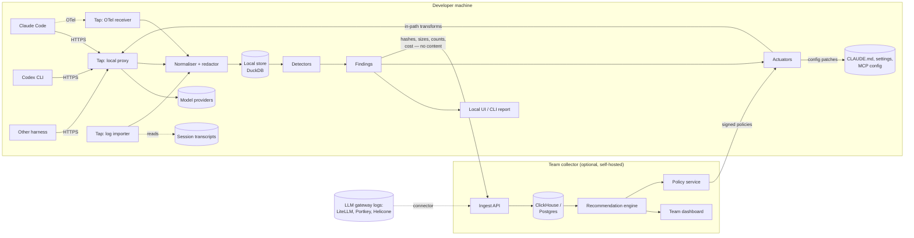

# Trimloop — Design

| | |
|---|---|
| Status | Draft |
| Last updated | 2026-11-05 |
| Scope | Whole system, MVP through auto-fix |

## 1. Goals and non-goals

### Goals

1. Capture model traffic from coding harnesses and LLM gateways with no change
   to how developers work.
2. Normalise it into one event model regardless of harness or provider.
3. Detect waste patterns and attach evidence and an estimated saving to each.
4. Roll findings up into team-level recommendations ranked by money saved.
5. Apply safe optimisations automatically, with shadow/canary rollout,
   measurement and one-switch rollback.
6. Keep source code and secrets on the developer's machine by default.

### Non-goals

- **Not an LLM gateway.** Trimloop sits alongside gateways (or reads their logs);
  it does not try to replace their routing, keys or rate limiting.
- **Not a general LLM observability platform.** No prompt playground, no eval
  authoring UI for arbitrary apps. Coding agents first.
- **Not a billing system.** Cost figures are estimates from a price catalogue,
  reconciled against invoices only where the user supplies them.
- **No semantic answer caching for code.** Reusing a model answer for a
  "similar" prompt is unsafe for code generation; Trimloop only exploits
  provider-side *prefix* caching, which is exact.
- **Not a RAG platform.** Trimloop recommends skills and documentation
  retrieval (P16–P18) and can hand a list of frequently used docs to a RAG
  builder, but it does not store document content or host indexes
  ([ADR 0007](adr/0007-recommend-skills-and-doc-retrieval.md)).

## 2. Users and jobs

| User | Job to be done |
|---|---|
| Individual developer | "Why did that session cost £14? Make my agent cheaper without making it dumber." |
| Platform / DevEx lead | "Which settings, CLAUDE.md files and MCP servers waste the most across the org? Fix them once." |
| Engineering manager / FinOps | "Forecast and cap coding-agent spend; show savings delivered." |
| Security | "Prove that no source code left our network to do any of this." |

## 3. Architecture



Four layers, each replaceable:

1. **Taps** — get traffic in.
2. **Normaliser** — one event model, with redaction and fingerprinting.
3. **Analysis** — detectors produce findings; the recommendation engine
   aggregates them.
4. **Actuators** — turn findings into changes: config patches or in-path
   transforms.

## 4. Taps (capture)

Different harnesses expose different surfaces, so there are four taps. All emit
the same raw envelope to the normaliser.

### 4.1 Local proxy

The richest source: full request and response bodies, including provider
cache-usage fields.

Two modes, because of a lesson from `claude-code-cache-fix`: pointing a
harness's base URL at a proxy can silently disable vendor features (for Claude
Code, Remote Control, `/schedule` and claude.ai connectors).

| Mode | How | Pros | Cons |
|---|---|---|---|
| **Forward proxy** (default) | `HTTPS_PROXY` + locally generated CA trusted only by the harness process | Base URL unchanged; vendor features keep working | CA management; some clients pin certificates |
| **Reverse proxy** | Harness base URL → `http://127.0.0.1:PORT` | Simple; no CA | May disable vendor features; per-harness config |

Rules for the proxy:

- Stream pass-through. Never buffer a whole SSE response before forwarding;
  tee the stream to the normaliser. Added latency budget: p99 < 5 ms.
- Never log `Authorization`, `x-api-key` or cookie headers. Auth is passed
  through untouched and never stored.
- Fail open. If Trimloop crashes or the analysis queue is full, traffic still
  flows; capture is dropped and a gap event is recorded.
- Scope the CA to the harness process (env var for the CA bundle), never install
  it system-wide by default.

### 4.2 OpenTelemetry receiver

An OTLP (gRPC + HTTP) endpoint for harnesses that export telemetry, e.g. Claude
Code's metrics and events, and anything emitting the OpenTelemetry GenAI
semantic conventions or OpenInference spans. Lower fidelity than the proxy (no
bodies) but zero-friction and safe to enable everywhere.

### 4.3 Transcript importer

Reads session files the harness already writes, e.g. Claude Code's JSONL
transcripts under `~/.claude/projects/` and Codex session logs. Works on
history, so a new user gets findings on day one with no proxy. This is the MVP
tap (see [ROADMAP.md](../ROADMAP.md)).

### 4.4 Gateway connectors

Pull or receive logs from LLM gateways (LiteLLM callbacks, Portkey/Helicone
log export, OpenRouter activity API). Lands at the team collector, not the
laptop. Gives coverage for traffic that never touches a developer machine
(CI agents, background agents).

### Coverage matrix (target)

| Harness / source | Proxy | OTel | Transcripts | Notes |
|---|---|---|---|---|
| Claude Code | ✅ | ✅ | ✅ | MVP target: cache-usage fields, rich transcripts |
| Codex CLI | ✅ | partial | ✅ | Responses API cache fields |
| Gemini CLI | ✅ | ? | ? | To investigate |
| Cursor | ❌ | ❌ | ❌ | Traffic goes to Cursor's backend, not the model provider; admin API only |
| GitHub Copilot | ❌ | ❌ | ❌ | Metrics API only |
| LiteLLM / Portkey / Helicone | — | — | — | Gateway connector |

Closed backends (Cursor, Copilot) get spend-level data only. That limit is
stated in the product rather than hidden.

## 5. Normaliser

Turns raw envelopes into the event model in [data-model.md](data-model.md).
Steps, in order:

1. **Parse** provider-specific payloads (Anthropic Messages, OpenAI Chat
   Completions and Responses, Gemini) into `Turn` + `Segment` records.
2. **Segment** each request's input into typed segments: system prompt, tool
   definitions, memory files (CLAUDE.md, AGENTS.md), conversation history,
   file reads, tool results, user message.
3. **Redact.** Run secret detection (entropy + known key formats) over segment
   text. Matches are replaced before anything is stored.
4. **Fingerprint.** For each segment, store a SHA-256 of normalised text, a
   rolling-hash chunk set (for near-duplicate detection), byte and token
   counts. Raw text is kept only if `capture.content = full` (default:
   `hashes`).
5. **Price.** Apply the versioned price catalogue (input, output, cache write,
   cache read; per model; per date) to produce `cost_estimate`.
6. **Attribute.** Attach developer, repo (from cwd + git remote), branch,
   harness, harness version, model.

Fingerprints are what make the privacy model work: detectors can tell that the
same 40 KB file was read nine times, or that the system prompt changes every
turn, without ever seeing the file or the prompt.

## 6. Analysis

The engine that runs detectors standalone, as a gateway sidecar or embedded
in a host is specified in [analyzer.md](analyzer.md).

### 6.1 Detectors

A detector is a pure function over a window of events that emits zero or more
`Finding`s:

```text
Finding {
  pattern_id      // e.g. P01-cache-prefix-churn
  scope           // turn | session | repo | developer | org
  evidence        // event ids, segment fingerprints, counts
  wasted_tokens   // by token class: input, cache_write, cache_read, output
  est_saving      // money, from the price catalogue
  confidence      // 0..1
  fix_ref         // which actuator / recommendation template applies
}
```

Detectors are versioned and written as SQL over DuckDB views where possible
(cheap to read, easy to unit-test against fixtures), falling back to Go for
sequence logic such as loop detection. The full catalogue is in
[patterns.md](patterns.md); their expected value is ranked in
[value.md](value.md#2-the-levers-ranked-by-expected-value). The highest-value
ones for the MVP:

- **Cache-prefix churn**: which segment broke the cached prefix, and how often.
- **Cache TTL expiry**: idle gaps longer than the cache lifetime, forcing
  re-writes.
- **Repeated reads**: the same file fingerprint entering context N times.
- **Oversized tool output**: huge test logs, directory listings, JSON dumps.
- **Unused tool definitions**: MCP tools sent on every request, never called.
- **Loops**: repeated identical tool calls, or edit → test → fail cycles with
  no diff progress.

### 6.2 Recommendation engine (team collector)

Aggregates findings across sessions, developers and repos, then:

1. **Groups** findings by root cause, e.g. 312 cache-churn findings across 14
   developers all trace to the same line in one repo's CLAUDE.md that embeds a
   timestamp.
2. **Ranks** by estimated weekly saving × confidence ÷ effort to fix.
3. **Renders** a recommendation from a template per harness, with the exact
   change: a diff to a file, a settings key, an MCP server to disable for a
   repo.
4. **Tracks** whether it was applied and the measured saving afterwards
   (before/after on the same repo and developer cohort).

This closed loop — recommend, apply, measure — is the core product. It is what
none of the existing tools do.

### 6.3 Outcome signals

Optimising cost alone will happily recommend "use the smallest model and stop
early". To prevent that, every session carries outcome signals collected
locally:

| Signal | Source |
|---|---|
| Session ended with a commit / PR | git |
| Tests passed at end of session | tool-call results |
| User interrupted or re-prompted with a correction | transcript |
| Session abandoned (no commit, short, ended mid-task) | heuristic |
| Edits reverted within 24 h | git |

These are noisy. They are used comparatively (cohort A vs cohort B), never as
an absolute quality score.

## 7. Actuators (fixing things)

Every actuator has a **safety level**. A team policy sets the maximum level
allowed; the default is 1.

| Level | Type | Examples | Gate |
|---|---|---|---|
| 0 | Report | Findings in CLI/UI | none |
| 1 | Config patch | Edit CLAUDE.md to move volatile lines below stable ones; disable an unused MCP server for a repo; add a tool-output limit to settings | Human approves a diff (local, or as a PR) |
| 2 | In-path transform, semantics-preserving | Re-order stable segments to the front; add cache breakpoints; de-duplicate identical tool definitions; extend cache TTL where the provider supports it | Shadow → canary → on, auto-rollback on regression |
| 3 | In-path transform, behaviour-changing | Truncate tool output with a retrievable pointer; route low-complexity turns to a cheaper model; cap thinking budget on trivial turns | Opt-in per repo, canary only, outcome signals must not regress |

### Rollout for levels 2 and 3

1. **Shadow.** Compute the transformed request, don't send it. Record what
   *would* have changed: predicted cache hit, tokens saved.
2. **Canary.** Apply to a percentage of sessions (by session, never by turn, so
   a conversation is internally consistent). Compare cost and outcome signals
   against the control.
3. **On.** Promote when savings are significant and no outcome signal
   regresses beyond a threshold.
4. **Kill switch.** One command or policy flag reverts every transform
   instantly. The proxy reverts to pure pass-through.

Transforms must be deterministic and logged: given the original request and
the transform version, the sent request can be reproduced exactly.

## 8. Security and privacy

| Threat | Mitigation |
|---|---|
| Source code / secrets leaving the machine | Default `capture.content = hashes`; team collector receives only fingerprints, counts, cost and findings; content upload requires an explicit per-repo opt-in |
| Secrets stored locally | Redaction before storage; local store encrypted at rest using the OS keychain |
| API keys captured by the proxy | Auth headers are never parsed, logged or stored |
| Malicious use of the local CA | CA private key generated per machine, stored in the OS keychain, scoped to harness processes via env var, 90-day rotation |
| Tampered policies pushing harmful transforms | Policies signed by the collector; actuators verify signatures; level 3 needs local opt-in as well as policy |
| Provider terms of service | Trimloop changes request *structure* (order, cache markers) but never impersonates a client or bypasses limits. Review each provider's terms before shipping level 2+ for it — see open questions |

## 9. Deployment modes

| Mode | Components | Storage | Who |
|---|---|---|---|
| **Solo** | Single `trimloop` binary: taps, normaliser, detectors, local UI | DuckDB file in `~/.trimloop/` | One developer |
| **Team** | Solo on each machine + self-hosted collector (container / Helm chart) | ClickHouse (events, findings), Postgres (policies, recommendations) | Org running it on its own infra |
| **Hosted** (later) | Same collector, run by us | Same | Teams that accept the hashes-only data model |

## 10. Technology choices

| Area | Choice | Why | ADR |
|---|---|---|---|
| Proxy, agent, CLI | Go | Single static binary; strong HTTP/2, TLS, SSE; easy cross-compile | [0002](adr/0002-go-for-agent-and-proxy.md) |
| LiteLLM gateway plugin | Python, thin: capture and forward to a `trimloop serve` sidecar | LiteLLM plugins must be Python; parsing, fingerprinting and detection stay in the Go core | [0005](adr/0005-thin-python-plugin-for-litellm.md), [0006](adr/0006-gateway-plugin-forwards-to-sidecar.md) |
| Local analytics | DuckDB | Embedded, fast SQL over columnar data; detectors as SQL | [0003](adr/0003-duckdb-local-clickhouse-team.md) |
| Team analytics | ClickHouse | High-volume event analytics; self-hostable | [0003](adr/0003-duckdb-local-clickhouse-team.md) |
| Wire format | OTLP + protobuf event schema | Reuse OTel ecosystem; versioned schema | [0001](adr/0001-capture-proxy-otel-transcripts.md) |
| UI | TypeScript web app, served by the binary | No separate install for solo mode | — |
| Privacy model | Hashes-only by default | Adoption depends on security sign-off | [0004](adr/0004-local-first-hashes-only.md) |

## 11. Risks

| Risk | Impact | Mitigation |
|---|---|---|
| Harness vendors ship their own optimisations (better caching, built-in analytics) | Erodes level-2 value | Lead with cross-harness team recommendations and outcome tracking, which vendors won't do across competitors |
| Harness traffic formats change without notice | Taps break | Fixture-based contract tests per harness version; fail open |
| Proxy adds latency or breaks streaming | Developers uninstall it | p99 latency budget, fail-open, transcript-only mode needs no proxy |
| Savings estimates are wrong | Loss of trust | Show method and confidence; reconcile against invoices where supplied |
| Optimisation hurts agent quality | Loss of trust | Outcome signals, canary, auto-rollback, level 3 opt-in only |
| Funded competitors move from spend tracking into optimisation | Market | Ship the transcript analyser fast; open-source the detectors to build distribution |

## 12. Open questions

See [ROADMAP.md](../ROADMAP.md#open-questions).
