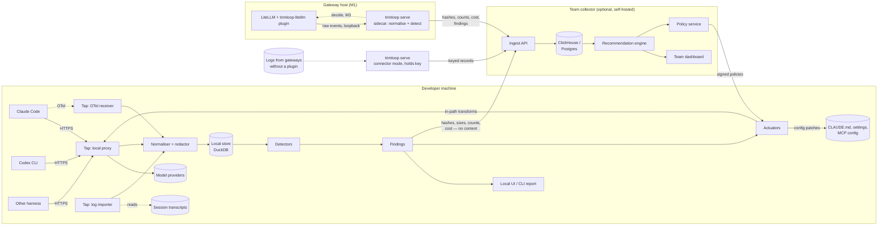

# Trimloop — Design

| | |
|---|---|
| Status | Draft |
| Last updated | 2026-11-08 |
| Scope | Whole system, MVP through auto-fix |

> **Today.** Only the M0 prototype is built. `trimloop analyse` reads Claude
> Code's logs, finds waste and writes a summary, text, HTML or JSON report;
> `trimloop setup`, `statusline` and `hook` give live nudges inside Claude
> Code. The code is in `cmd/`, `internal/` and `pkg/` (see
> [development.md](development.md)). How each figure is worked out:
> [measurements.md](measurements.md). The measured figures:
> [log-signals.md §8](log-signals.md#8-measured-figures-at-a-glance). What
> is next: [ROADMAP.md](../ROADMAP.md) and the Built column of the
> [ADR index](adr/README.md). **Everything else in this document is the
> target design.**

## 1. Goals and non-goals

### Goals

1. Capture model traffic from coding harnesses and LLM gateways with no change
   to how developers work.
2. Normalise it into one event model regardless of harness or provider.
3. Detect waste patterns and attach evidence and an estimated saving to each.
4. Roll findings up into team-level recommendations ranked by money saved.
5. Apply safe optimisations automatically, with shadow/canary rollout,
   measurement and one-switch rollback.
6. Keep source code and secrets on the developer's machine by default.

### Non-goals

- **Not an LLM gateway.** Trimloop sits alongside gateways (or reads their logs);
  it does not try to replace their routing, keys or rate limiting.
- **Not a general LLM observability platform.** No prompt playground, no eval
  authoring UI for arbitrary apps. Coding agents first.
- **Not a billing system.** Cost figures are estimates from a price catalogue,
  reconciled against invoices only where the user supplies them.
- **No semantic answer caching for code.** Reusing a model answer for a
  "similar" prompt is unsafe for code generation; Trimloop only exploits
  provider-side *prefix* caching, which is exact.
- **Not a RAG platform.** Trimloop recommends skills and documentation
  retrieval (P16–P18) and can hand a list of frequently used docs to a RAG
  builder, but it does not store document content or host indexes
  ([ADR 0007](adr/0007-recommend-skills-and-doc-retrieval.md)).

## 2. Users and jobs

| User | Job to be done |
|---|---|
| Individual developer | "Why did that session cost £14? Make my agent cheaper without making it dumber." |
| Platform / DevEx lead | "Which settings, CLAUDE.md files and MCP servers waste the most across the org? Fix them once." |
| Engineering manager / FinOps | "Forecast and cap coding-agent spend; show savings delivered." |
| Security | "Prove that no source code left our network to do any of this." |

## 3. Architecture

Four layers, each replaceable:

1. **Taps** — get traffic in.
2. **Normaliser** — one event model, with redaction and fingerprinting.
3. **Analysis** — detectors produce findings; the recommendation engine
   aggregates them.
4. **Actuators** — turn findings into changes: config patches or in-path
   transforms.

## 4. Taps (capture)

Different harnesses and gateways expose different surfaces, so there are four
kinds of tap: local proxy, OTLP receiver, transcript reader and gateway
(plugin plus sidecar, or log connector). All emit the same raw envelope to the
normaliser. Ship order: transcripts (M0), gateway sidecar (M1), OTLP and log
connectors (M2), local proxy (M4) — see
[ADR 0009](adr/0009-gateway-sidecar-before-local-proxy.md).

### 4.1 Local proxy

The richest source: full request and response bodies, including provider
cache-usage fields.

Two modes, because of a lesson from `claude-code-cache-fix`: pointing a
harness's base URL at a proxy can silently disable vendor features (for Claude
Code, Remote Control, `/schedule` and claude.ai connectors).

| Mode | How | Pros | Cons |
|---|---|---|---|
| **Forward proxy** (default) | `HTTPS_PROXY` + locally generated CA trusted only by the harness process | Base URL unchanged; vendor features keep working | CA management; some clients pin certificates |
| **Reverse proxy** | Harness base URL → `http://127.0.0.1:PORT` | Simple; no CA | May disable vendor features; per-harness config |

Rules for the proxy:

- Stream pass-through. Never buffer a whole SSE response before forwarding;
  tee the stream to the normaliser. Added latency budget: p99 < 5 ms.
- Never log `Authorization`, `x-api-key` or cookie headers. Auth is passed
  through untouched and never stored.
- Fail open where possible. If the analysis queue is full or analysis fails,
  traffic still flows; capture is dropped and a gap event is recorded. If the
  proxy *process* dies, requests routed through it fail, so `trimloop proxy`
  runs under a supervisor (launchd, systemd) and the harness launcher checks
  the proxy is listening before routing traffic to it, falling back to a
  direct connection if not.
- Scope the CA to the harness process (env var for the CA bundle), never install
  it system-wide by default.

### 4.2 OpenTelemetry receiver

An OTLP (gRPC + HTTP) endpoint for harnesses that export telemetry, e.g. Claude
Code's metrics and events, and anything emitting the OpenTelemetry GenAI
semantic conventions or OpenInference spans. Lower fidelity than the proxy (no
bodies) but zero-friction and safe to enable everywhere.

### 4.3 Transcript importer

Reads session files the harness already writes, e.g. Claude Code's JSONL
transcripts under `~/.claude/projects/`. Works on history, so a new user gets
findings on day one with no proxy. This is the MVP tap: the Claude Code
reader is built; a reader for Codex session logs follows in M1 (see
[ROADMAP.md](../ROADMAP.md)).

### 4.4 Gateway taps

Two forms, both covering traffic that never touches a developer machine (CI
agents, background agents):

- **Plugin plus sidecar (M1).** A thin plugin inside the gateway (LiteLLM
  first) forwards raw events over loopback to a `trimloop serve` sidecar on
  the same host. Only hashes, counts, cost and findings leave the host. The
  sidecar is specified in
  [analyzer.md §5.2](analyzer.md#52-gateway-sidecar-trimloop-serve)
  (ADRs [0005](adr/0005-thin-python-plugin-for-litellm.md) and
  [0006](adr/0006-gateway-plugin-forwards-to-sidecar.md)).
- **Log connectors (M2).** For gateways without a plugin (Portkey/Helicone log
  export, OpenRouter activity API): pulled or received by `trimloop serve` in
  connector mode, which holds the fingerprint key and forwards keyed records
  to the team collector ([ADR 0011](adr/0011-keyed-fingerprints.md)). Usually
  lower fidelity — usage and metadata rather than full bodies.

### Coverage matrix (target)

| Harness / source | Proxy | OTel | Transcripts | Notes |
|---|---|---|---|---|
| Claude Code | ✅ | ✅ | ✅ | MVP target: cache-usage fields, rich transcripts |
| Codex CLI | ✅ | partial | ✅ | Responses API cache fields |
| Gemini CLI | ✅ | ? | ? | To investigate |
| Cursor | ❌ | ❌ | ❌ | Traffic goes to Cursor's backend, not the model provider; admin API only |
| GitHub Copilot | ❌ | ❌ | ❌ | Metrics API only |
| LiteLLM | — | — | — | Gateway plugin + sidecar (M1) |
| Portkey / Helicone | — | — | — | Log connector, `serve` connector mode (M2) |

Closed backends (Cursor, Copilot) get spend-level data only. That limit is
stated in the product rather than hidden.

## 5. Normaliser

Turns raw envelopes into the event model in [data-model.md](data-model.md).
Steps, in order:

1. **Parse** provider-specific payloads (Anthropic Messages, OpenAI Chat
   Completions and Responses, Gemini) into `Turn` + `Segment` records.
2. **Segment** each request's input into typed segments: system prompt, tool
   definitions, memory files (CLAUDE.md, AGENTS.md), conversation history,
   file reads, tool results, user message.
3. **Redact.** Run secret detection (entropy + known key formats) over segment
   text. Matches are replaced before any text is stored; hashes are taken
   from the original text (see the fingerprinting specification).
4. **Fingerprint.** With the customer's fingerprint key (HMAC), store for each
   segment an exact hash, a content hash,
   line hashes where applicable, and byte and token counts
   ([specification](data-model.md#fingerprinting)). Raw text is kept only if `capture.content = full` (default:
   `hashes`).
5. **Price.** Apply the versioned price catalogue (input, output, cache write,
   cache read; per model; per date) to produce `cost_estimate`.
6. **Attribute.** Attach developer, repo (from cwd + git remote), branch,
   harness, harness version, model.

Fingerprints are what make the privacy model work: detectors can tell that the
same 40 KB file was read nine times, or that the system prompt changes every
turn, without ever seeing the file or the prompt.

## 6. Analysis

The engine that runs detectors standalone, as a gateway sidecar or embedded
in a host is specified in [analyzer.md](analyzer.md).

### 6.1 Detectors

A detector emits zero or more `Finding`s, each with evidence, wasted tokens by
class, an estimated saving (an upper bound, plus a likely figure where one
can be measured), a confidence and a reference to the fix that applies. The
schema is defined once, in [data-model.md](data-model.md#finding).

In the target design, turn- and session-scope detectors will be versioned Go
state machines that run unchanged over history and live traffic, and
cross-session detectors will be SQL aggregates over the store
([ADR 0010](adr/0010-go-detectors-sql-aggregates.md),
[analyzer.md §7](analyzer.md#7-detector-execution)). Today the prototype's
detectors are one-pass Go functions over finished sessions, in
`pkg/detectors` (for example `FindLongPauses` for P09 and `FindEffort` for
P14).

The full catalogue is in [patterns.md](patterns.md); the expected value of
each is ranked in [value.md](value.md#2-the-levers-ranked-by-expected-value).
Which findings are built, and the order of the rest, are in the
[ROADMAP build order](../ROADMAP.md#m0--transcript-analyser-mvp) and
patterns.md; how each built one is worked out is in
[measurements.md](measurements.md).

### 6.2 Recommendation engine (team collector)

Aggregates findings across sessions, developers and repos, then:

1. **Groups** findings by root cause, e.g. 312 cache-churn findings across 14
   developers all trace to the same line in one repo's CLAUDE.md that embeds a
   timestamp.
2. **Ranks** by estimated weekly saving × confidence ÷ effort to fix, and
   chooses each recommendation's fix by the fix ladder: one primary fix and
   up to two alternatives of different kinds, all failure-preserving
   ([ADR 0030](adr/0030-how-fixes-are-chosen.md)).
3. **Describes** the fix as a template id plus keyed parameters (which
   segment, which line hash, which MCP server). The collector holds no
   content, so it cannot write the change itself.
4. **Renders locally.** On a developer machine, `trimloop recommendations`
   fetches the open recommendations, resolves the keyed parameters against the
   local repo and harness logs, and renders the exact change — a diff to a
   file, a settings key, an MCP server to disable — for a person to apply or
   open as a PR. Gateway-only teams (no Trimloop on developer machines) see the
   recommendation's title, saving and template text in the dashboard; any
   developer who runs `trimloop recommendations` in the repo gets the diff.
5. **Tracks** whether it was applied and the measured saving afterwards
   (before/after on the same repo and developer cohort), with side effects;
   escalates to a stronger fix kind when no saving is seen, and recommends a
   roll-back when side effects rise (ADR 0030).

This closed loop — recommend, apply, measure — is the core product. It is what
none of the existing tools do.

### 6.3 Outcome signals

Optimising cost alone will happily recommend "use the smallest model and stop
early". To prevent that, every session carries outcome signals collected
locally:

| Signal | Source |
|---|---|
| Session ended with a commit / PR | git |
| Tests passed at end of session | tool-call results |
| User interrupted or re-prompted with a correction | transcript |
| Session abandoned (no commit, short, ended mid-task) | heuristic |
| Edits reverted within 24 h | git |
| Lines added and removed | harness record (`outcome.lines_changed`) |
| Tool error rate, tool denials | tool-call results, harness record |
| Prompts queued while the agent was busy | harness record |
| Edits that collided with the user's own changes | tool-call results |
| Time spent in retries | harness record (`harness.retries`) |

At a gateway, git and test signals are not visible. Gateway rollouts use what
the gateway can see: provider error and retry rates, tool-call error rate,
turns per session, sessions ending on an error, and user corrections
([ADR 0013](adr/0013-decide-path-and-transform-safety.md)).

These are noisy. They are used comparatively (cohort A vs cohort B), never as
an absolute quality score.

## 7. Actuators (fixing things)

Every actuator has a **safety level**, L0 to L3 (the "Level" column below). A
team policy sets the maximum level allowed; the default is L1.

| Level | Type | Examples | Gate |
|---|---|---|---|
| 0 | Report | Findings in CLI/UI | none |
| 1 | Config patch | Edit CLAUDE.md to move volatile lines below stable ones; disable an unused MCP server for a repo; add a tool-output limit to settings | Human approves a diff (local, or as a PR) |
| 2 | In-path transform, semantics-preserving | Sort tool definitions (where tool order is shown not to matter, ADR 0018); add cache breakpoints within the provider's limit; choose the cache TTL; set a cache key | Shadow → canary → on, auto-rollback on regression; rejected requests resent untransformed |
| 3 | In-path transform, behaviour-changing | `move_segment`, `truncate_tool_result`, `elide_segment`, `route_model`, `cap_thinking` (all M4; [ADR 0021](adr/0021-decide-body-ops-and-policy-signing.md)) | Opt-in per repo, canary only, outcome signals must not regress; not at a gateway until developer-side outcomes are joined (M4) |

### Rollout for levels 2 and 3

1. **Shadow.** Compute the transformed request, don't send it. Record what
   *would* have changed: predicted cache hit, tokens saved.
2. **Canary.** Apply to a percentage of sessions (by session, never by turn, so
   a conversation is internally consistent; the bucket comes from the keyed
   session anchor and the experiment id, so it needs no session state and
   each experiment splits independently — [ADR 0020](adr/0020-session-identity.md)).
   Compare cost and outcome signals against the control.
3. **On.** Promote when savings are significant and no outcome signal
   regresses beyond a threshold.
4. **Kill switch.** One command or policy flag reverts every transform
   instantly. The proxy reverts to pure pass-through.

Transforms must be deterministic and logged: given the original request and
the transform version, the sent request can be reproduced exactly.

## 8. Security and privacy

**Today.** The M0 prototype reads logs on the developer machine and sends
nothing anywhere. Its local reports show project names and session titles
([ADR 0032](adr/0032-readable-reports.md)); its stored files hold numbers
only; `trimloop setup --write` edits Claude Code's settings only when asked,
after a backup ([ADR 0034](adr/0034-live-nudges.md)). The table below is the
target design: keyed fingerprints, redaction, the proxy and signed policies
are not built yet.

| Threat | Mitigation |
|---|---|
| Source code / secrets leaving the machine | Default `capture.content = hashes`; the team collector receives only keyed fingerprints, counts, cost and findings. Content is never uploaded; full capture is a per-repo opt-in that stays on the developer machine and never applies to a sidecar |
| Guessing attacks on fingerprints (hash a likely path, URL or secret and look for a match) | Fingerprints are HMAC-SHA-256 with a customer-held key the collector never receives; names (paths, URLs, repo, branch, MCP servers) are keyed by default ([ADR 0011](adr/0011-keyed-fingerprints.md)) |
| Secrets stored locally | Redaction before storage; by default the store holds only keyed hashes and is protected by file permissions. Encryption at rest becomes required when full-content capture is enabled ([ADR 0015](adr/0015-defer-local-store-encryption.md)) |
| API keys captured by the proxy | Auth headers are never parsed, logged or stored |
| Malicious use of the local CA | CA private key generated per machine, stored in the OS keychain, scoped to harness processes via env var, 90-day rotation |
| Tampered policies pushing harmful transforms | Policies signed with a customer-held policy key the collector never holds; sidecars and proxies verify against that trust anchor; L3 needs local opt-in as well as policy ([ADR 0021](adr/0021-decide-body-ops-and-policy-signing.md)) |
| Provider terms of service | Trimloop changes request *structure* (order, cache markers) but never impersonates a client or bypasses limits. Review each provider's terms before shipping L2 and above for it — see open questions |

## 9. Deployment modes

| Mode | Components | Storage | Who |
|---|---|---|---|
| **Solo** | Single `trimloop` binary: taps, normaliser, detectors, local UI | DuckDB file in `~/.trimloop/` | One developer |
| **Gateway sidecar** | `trimloop serve` beside each gateway instance, plus the gateway plugin (container / Helm sidecar mode) | Memory or DuckDB on the gateway host | Team running LiteLLM (M1) |
| **Team** | Solo and/or gateway sidecars + self-hosted collector (container / Helm collector mode) | ClickHouse (events, findings), Postgres (policies, recommendations) | Org running it on its own infra |
| **Hosted** (later) | Same collector, run by us | Same | Teams that accept the hashes-only data model |

How each mode is packaged and released (one binary, one container image,
one Helm chart, one Python package) is in [packaging.md](packaging.md).

## 10. Technology choices

| Area | Choice | Why | ADR |
|---|---|---|---|
| Proxy, agent, CLI | Go | Single binary (built per OS because DuckDB needs cgo); strong HTTP/2, TLS, SSE | [0002](adr/0002-go-for-agent-and-proxy.md), [0014](adr/0014-release-builds-per-os.md) |
| LiteLLM gateway plugin | Python, thin: capture and forward to a `trimloop serve` sidecar | LiteLLM plugins must be Python; parsing, fingerprinting and detection stay in the Go core | [0005](adr/0005-thin-python-plugin-for-litellm.md), [0006](adr/0006-gateway-plugin-forwards-to-sidecar.md) |
| Local analytics | DuckDB | Embedded, fast SQL over columnar data; cross-session aggregates in SQL | [0003](adr/0003-duckdb-local-clickhouse-team.md), [0010](adr/0010-go-detectors-sql-aggregates.md) |
| Team analytics | ClickHouse | High-volume event analytics; self-hostable | [0003](adr/0003-duckdb-local-clickhouse-team.md) |
| Wire format | OTLP + protobuf event schema | Reuse OTel ecosystem; versioned schema | [0001](adr/0001-capture-proxy-otel-transcripts.md) |
| UI | TypeScript web app, served by the binary | No separate install for solo mode | — |
| Privacy model | Keyed hashes only by default, customer-held key | Adoption depends on security sign-off | [0004](adr/0004-local-first-hashes-only.md), [0011](adr/0011-keyed-fingerprints.md), [0024](adr/0024-developer-identity-and-key-handling.md) |

## 11. Risks

| Risk | Impact | Mitigation |
|---|---|---|
| Harness vendors ship their own optimisations (better caching, built-in analytics) | Erodes level-2 value | Lead with cross-harness team recommendations and outcome tracking, which vendors won't do across competitors |
| Harness traffic formats change without notice | Taps break | Fixture-based contract tests per harness version; fail open |
| Proxy adds latency or breaks streaming | Developers uninstall it | p99 latency budget, fail-open, transcript-only mode needs no proxy |
| Savings estimates are wrong | Loss of trust | Show method and confidence; reconcile against invoices where supplied |
| Optimisation hurts agent quality | Loss of trust | Outcome signals, canary, auto-rollback, L3 opt-in only |
| Funded competitors move from spend tracking into optimisation | Market | Ship the transcript analyser fast; open-source the detectors to build distribution |

## 12. Open questions

See [ROADMAP.md](../ROADMAP.md#open-questions).
