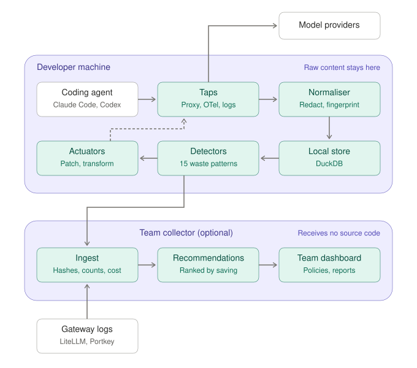

# The plan

This page is design, not built yet, apart from the parts the picture below
marks M0. What the prototype does today is in the [README](../README.md).

Teams spend real money on coding agents (Claude Code, Codex, Cursor, Copilot)
and on gateways that route their requests (LiteLLM, Portkey, Helicone,
OpenRouter). The tools we have seen answer *where* the money went; few say
*why it was wasted* or *what to change*. Trimloop is designed to join four
steps:

1. **Capture** requests from any coding agent or gateway.
2. **Detect** waste patterns: the ones above, and more
   ([docs/patterns.md](patterns.md)).
3. **Recommend** fixes ranked by money saved, across a whole team.
4. **Apply** the safe ones automatically, with measurement and rollback.

Principles it is designed around:

- **Local-first.** Prompts contain source code and secrets. Raw content will
  never leave the developer's machine unless explicitly enabled; teams will
  share keyed hashes (fingerprints only the customer's key can make), sizes,
  counts and cost, not code or names
  ([ADR 0011](adr/0011-keyed-fingerprints.md),
  [ADR 0019](adr/0019-fingerprint-key-management.md)).
- **Observe before acting.** Recommendations first; changes Trimloop would
  make to requests itself will ship report-only, then in shadow mode
  (worked out and logged, not applied), then to a few, then to all, each
  measured and reversible.
- **Quality is a constraint.** A saving that makes the agent worse is not a
  saving: Trimloop is to track outcome signals (tests, edits, errors) alongside
  cost.
- **Neutral.** One event model for every coding agent, gateway and model
  provider; their differences live in profiles, not in the detectors.

<picture>
  <source media="(prefers-color-scheme: dark)" srcset="images/architecture-dark.svg">
  
</picture>

Boxes marked **M0** exist today, in part: the prototype reads Claude Code's
logs (not live traffic yet), runs 9 of the 19 waste patterns, and gives a
report and nudges. Everything else in the picture is planned.

The core will be one Go program; a thin Python plugin will connect LiteLLM to
it; a web UI (TypeScript) will be embedded in the program. Detail:
[docs/design.md](design.md), [docs/analyzer.md](analyzer.md),
[ROADMAP.md](../ROADMAP.md) for the order, and
[docs/adr/README.md](adr/README.md) for every decision with whether it is
built.
